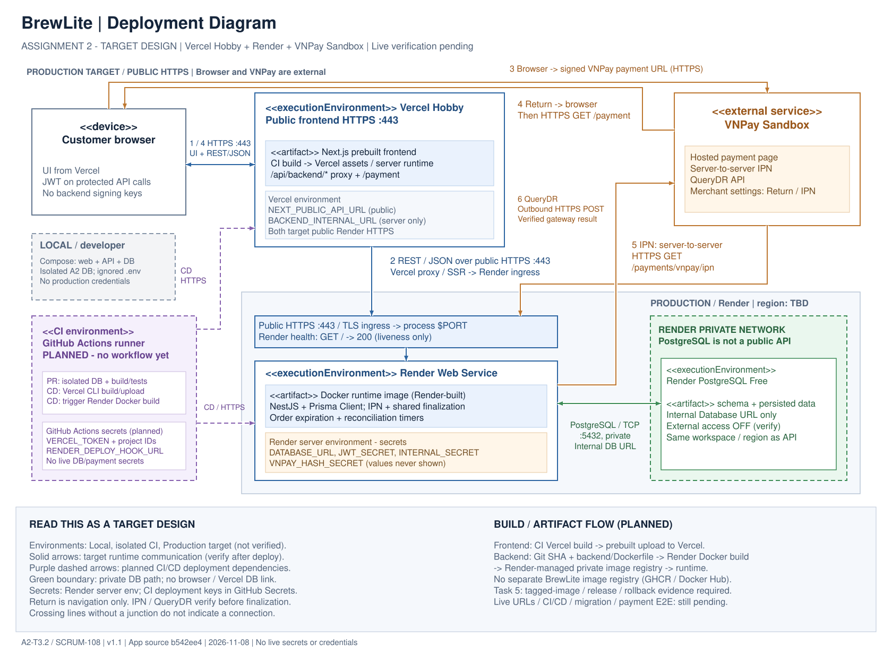

# BrewLite - Deployment Diagram: Vercel & Render

> **Cập nhật SCRUM-117, 11/11/2026:** §§1–10 giữ provenance thiết kế SCRUM-108;
> không dùng snapshot `b542ee4` bên dưới như source hiện hành. Đối chiếu remote
> `dev` và HEAD của branch SCRUM-117 hiện tại: `5021743e99d73c2ce795df72ee5aaa90b04bb0da`;
> CI hiện đã có `.github/workflows/ci.yml`, chưa có CD trong tree; các mô tả
> “chưa có workflow” bên dưới chỉ đúng snapshot thiết kế cũ. ADR-005 vẫn Proposed.
> [Readiness và evidence SCRUM-117](delivery/SCRUM-117-delivery.md) ghi các gate
> runtime còn thiếu. Runbook hiện hành bổ sung ở §11; không deployment/rollback
> production trong lượt chuẩn bị hồ sơ.
>
> **Sau review SCRUM-117:** 8 AC đã được người dùng cung cấp tại
> [delivery §2](delivery/SCRUM-117-delivery.md#2-readiness-theo-acceptance-criteria).
> Các checklist thiết kế lịch sử bên dưới không tự thêm gate vào AC này.
> Payment-status/QueryDR cần đối chiếu scope release theo
> [bảng nguồn và tác động](delivery/SCRUM-117-delivery.md#phạm-vi-release-gap-và-quyết-định-cần-xác-nhận);
> rehearsal chưa có căn cứ bắt buộc. Runbook theo candidate provider không
> chứng minh đã thực thi được trên môi trường thật chưa có ID/tier.
>
> **Nguồn đề đã bổ sung:** [Assignment 2 v1.0](https://drive.google.com/file/d/1CYVsexpTXZ6Uyg2FHMRE8lnJHSPkYQmi/view),
> §7.3 yêu cầu image tag theo SHA/semantic version, push registry khi nền tảng
> yêu cầu, safe migration và health/smoke sau deploy. §7.2 chỉ nêu GET /health
> làm ví dụ; source hiện có GET /, không cần tự đặt endpoint mới. §7.4/9.1 yêu
> cầu rollback guide, không nêu rehearsal. Các câu “nếu rubric yêu cầu” trong
> snapshot thiết kế cũ được hiểu theo nguồn mới này; không tự thêm registry
> độc lập hoặc coi host-build chưa có image version evidence là đã đáp ứng.
>
> **Source hiện tại tại HEAD 5021743:** PR #16 của SCRUM-116
> chỉ nâng Next.js 16.4.6 và sửa web proxy. Response proxy bỏ connection,
> keep-alive, transfer-encoding, content-length, content-encoding; 502 public
> dùng message chung, error được log phía server. Không suy đã rà sạch log hoặc
> đã sửa nguyên nhân 502 lịch sử. Biến proxy, URL resolution, health, Docker/
> Compose, migration/seed và workflow không đổi; hướng dẫn ở §11 vẫn có điều
> kiện theo candidate provider/tier. [Evidence/new baseline](delivery/SCRUM-117-delivery.md#12-đối-chiếu-dev-mới-5021743-chưa-tích-hợp)
> phân biệt CI của PR #16 với deploy/smoke còn follow-up.

| Thuộc tính | Giá trị |
| --- | --- |
| Task | A2-T3.2 / SCRUM-108 |
| Phiên bản | 1.1 - sửa DEP-01/02/03 sau review vòng 1, PR #6 |
| Ngày đối chiếu source và tài liệu hosting | 08/11/2026 |
| Source snapshot | `b542ee4`, cùng commit với `origin/dev` tại thời điểm kiểm tra local |
| Trạng thái | **TARGET DESIGN - CHƯA XÁC MINH MÔI TRƯỜNG DEPLOY** |
| Review base | `dev` |

Đây là kiến trúc được chọn để triển khai thử: Next.js trên Vercel Hobby, NestJS
trên Render Web Service, Render PostgreSQL Free, GitHub Actions cho CI/CD và
VNPay Sandbox. Các node thể hiện đích triển khai, không xác nhận dịch vụ đã được
tạo hay đã chạy thành công. Chưa có URL, service ID, region hoặc dashboard
evidence thực tế được xác minh trong task này. Không triển khai production,
thay đổi nghiệp vụ thanh toán, endpoint, Prisma Schema hoặc workflow CI/CD.

## 1. Sơ đồ và cách đọc



- [Nguồn chỉnh sửa bằng diagrams.net](diagrams/brewlite-deployment.drawio).
- [SVG vector](diagrams/brewlite-deployment.svg) và [PDF vector một trang](diagrams/brewlite-deployment.pdf).
- [Đoạn chèn LaTeX](diagrams/deployment-figure.tex) và [hướng dẫn xuất lại](diagrams/deployment-README.md).

`<<device>>` là thiết bị người dùng; `<<executionEnvironment>>` là môi trường
chạy; `<<artifact>>` là thành phần triển khai. Khung xanh lá là phần kết nối DB
private trong Render; vùng public HTTPS nằm ngoài khung này. Nét liền mô tả
đường giao tiếp của thiết kế đích; nét đứt tím là dependency triển khai CI/CD
**chưa được cấu hình**. Mọi đường liền cũng phải được kiểm chứng sau deploy.
Số 1-6 trên hình khớp bảng kết nối ở mục 3; đó không phải thứ tự callback bắt buộc.
Return (4) về Browser rồi dùng lại kết nối Browser → Vercel (nhãn `1 / 4`) để
gửi request `/payment`; không có đường Return server-to-server tới frontend.

### 1.1. Local / CI / Production là các phạm vi riêng

| Phạm vi trên hình | Runtime / dữ liệu | Build và quyền truy cập |
| --- | --- | --- |
| **LOCAL / developer** | Docker Compose web + API + PostgreSQL trên máy developer; DB/volume A2 riêng | `.env` local không commit; không sử dụng DB, volume hoặc credential production |
| **CI environment** | GitHub Actions runner tạm thời; database test cô lập trong CI, chưa có workflow ở snapshot | CI build/test; job CD được phép mới nhận deployment token/hook từ GitHub Secrets. Không có kết nối tới Render DB private |
| **PRODUCTION TARGET** | Vercel frontend, Render backend và PostgreSQL managed; Browser/VNPay là bên ngoài gọi public endpoints | Runtime secrets nằm tại host tương ứng; chỉ backend có private DB connection. Môi trường đích chưa được deploy/kiểm chứng trong T3.2 |

Khung Local và CI nằm riêng với các node hosted Production target. Đây là ranh
giới environment/quyền truy cập; khung xanh lá bên trong Render biểu diễn ranh
giới **mạng private**, không phải một environment thứ tư. Không chia sẻ dữ liệu
hoặc secrets production cho Local/CI. Đường CD nét đứt chỉ tác động control plane,
không chuyển DB credential sang runner. Build có thể chạy trong CI hoặc trên
builder của nền tảng theo §7.1; builder không phải NestJS runtime.

## 2. Deployment nodes và artifacts

| Node | Thành phần triển khai | Exposure và cấu hình cần xác minh |
| --- | --- | --- |
| Browser của Customer | HTML/CSS/JavaScript từ Next.js; JWT dùng cho API cần đăng nhập | Public Internet; không chứa DB credential, JWT signing secret hoặc VNPay HashSecret |
| Vercel Hobby | Next.js từ `apps/web/`, CLI build trong CI rồi upload prebuilt artifact; static assets/CDN; server runtime cho Route Handler `/api/backend/*` và server rendering khi có | Frontend public HTTPS `:443`; project, domain, environment và quyền deploy **TBD** |
| Render Web Service | Render build `apps/api/Dockerfile` thành Docker runtime image từ Git commit; NestJS `dist/main.js`, Prisma Client; IPN handler; order-expiration và payment-reconciliation schedulers trong cùng process | Backend public HTTPS `:443`; ingress chuyển tới process nghe `$PORT`; region/tier/service ID **TBD** |
| Render PostgreSQL Free | PostgreSQL; dữ liệu và các migration đã có trong `apps/api/prisma/migrations/` | Backend dùng Internal Database URL qua Render private network, PostgreSQL/TCP `:5432`; cùng workspace và region với backend |
| GitHub / GitHub Actions | Repository, CI runner, build/test jobs và dependency CD tới Vercel/Render | Control plane qua HTTPS; dự kiến, chưa có `.github/workflows/` trong snapshot |
| VNPay Sandbox | Hosted payment page, IPN sender và QueryDR API | External service public HTTPS; merchant Sandbox và callback registration cần kiểm chứng |

Trong backend, request đi qua **Controller → Service → Prisma → PostgreSQL**.
JWT Guard xác minh Customer; Service áp dụng quyền sở hữu và business rules.
IPN đi qua controller public riêng, xác minh chữ ký và dữ liệu gateway trước
shared finalization/transaction. Hai scheduler là thành phần trong NestJS,
không phải Render Cron Job hoặc worker riêng.

## 3. Giao thức, kết nối và ranh giới mạng

| ID trên hình | Nguồn → đích | Giao thức / mục đích | Trust boundary |
| --- | --- | --- | --- |
| 1 | Browser ↔ Vercel | HTTPS `:443`: tải UI; REST/JSON tới `/api/backend/*`, chuyển Bearer JWT khi endpoint yêu cầu | Internet → frontend public |
| 2 | Vercel server runtime ↔ Render ingress → NestJS | REST/JSON qua HTTPS `:443` tới URL backend public; ingress tới process `$PORT` | Vercel → Render qua Internet, **không phải private link** |
| 3 | Browser → VNPay | Browser điều hướng tới `paymentUrl` do backend ký sau initiation | Browser → gateway public; không ghi signed URL vào evidence |
| 4 | VNPay điều hướng Browser → Vercel `/payment` | HTTPS Return qua browser; UI đọc lại trạng thái có thẩm quyền từ backend khi API đó sẵn sàng | Return parameters là input không tin cậy; không finalize |
| 5 | VNPay server → Render `/payments/vnpay/ipn` | HTTPS GET server-to-server; không Customer JWT; HMAC và kiểm tra merchant/transaction/amount theo contract | Gateway public → backend public, không qua browser/Vercel |
| 6 | NestJS reconciliation → VNPay QueryDR | HTTPS POST JSON outbound; xác minh response trước shared finalization | Backend → external gateway; không chạy từ browser polling |
| DB | Prisma ↔ PostgreSQL | PostgreSQL wire protocol/TCP `:5432`, Internal Database URL | Backend → Render private network; không phải REST/HTTP API |
| CD nét đứt | GitHub Actions → Vercel / Render control plane | HTTPS deploy dependency sau checks và quyền triển khai phù hợp | Control plane; không phải traffic người dùng hoặc đường truy cập DB |

Luồng browser chính phù hợp `apps/web/services/payment.service.ts`:
`resolveBackendEndpoint()` dùng `/api/backend/...` khi có `window`.
`apps/web/app/api/backend/[[...path]]/route.ts` forward request tới
`BACKEND_INTERNAL_URL`, rồi mới fallback sang `NEXT_PUBLIC_API_URL`.
Trên Vercel, **cả hai biến này phải dùng public HTTPS backend origin phù hợp**;
`http://backend:3001` chỉ có ý nghĩa trong Docker Compose local. Proxy này là
Next.js Route Handler, không phải cấu hình `rewrites()` trong `next.config.ts`.

Một số service có fallback browser gọi trực tiếp `NEXT_PUBLIC_API_URL`.
`apps/api/src/main.ts` chưa có `enableCors()`. Vì vậy không coi đường browser →
Render trực tiếp là đã hoạt động; phải kiểm tra bằng trình duyệt thực tế. Nếu cần
đường đó, cấu hình CORS theo origin frontend được duyệt trong task triển khai,
không âm thầm bổ sung ở task tài liệu này. CORS không thay thế JWT/ownership và
không áp dụng cho IPN server-to-server.

Render cho phép Web Service Free **gửi** private network request, dù không
nhận inbound private traffic. Backend và DB cần cùng workspace/region; Vercel
không thuộc mạng này. [Render Private Network](https://render.com/docs/private-network).

**Private connection không tự tắt external database access.** Thiết kế đích yêu
cầu tắt external DB access trong Render Networking; cần evidence đã áp dụng.
Render mặc định cho phép kết nối external từ mọi IP nếu có credential. Không
đưa External Database URL vào Vercel, browser hoặc GitHub-hosted runner. Chưa
xác minh TLS trên đường DB internal; ghi lại cấu hình và kết quả thực tế sau
deploy, không gán nhãn HTTPS hay khẳng định TLS cho kết nối này.
[Render Postgres connectivity](https://render.com/docs/postgresql-creating-connecting).

## 4. VNPay Return, IPN và QueryDR

1. Browser gọi `POST /api/backend/payments/vnpay/initiate`; proxy chuyển tới
   `POST /payments/vnpay/initiate`. Endpoint yêu cầu Bearer JWT và
   `Idempotency-Key` theo API Contract v4.0 §3. Backend kiểm tra ownership,
   tính từ Order snapshot và tạo signed payment URL bằng secret phía server.
2. Backend trả payment URL cho frontend; browser điều hướng sang Sandbox.
   Không có kết nối browser → database và không cấp HashSecret cho frontend.
3. **Return:** VNPay điều hướng browser về `VNPAY_RETURN_URL`, đích dự kiến
   `${FRONTEND_ORIGIN}/payment`. Return có thể đến trước hoặc sau IPN; người dùng
   cũng có thể đóng browser. Không tin query string để kết luận đã thanh toán.
4. **IPN:** VNPay gọi trực tiếp `${BACKEND_ORIGIN}/payments/vnpay/ipn`, không
   cần phiên browser/Customer JWT. Backend kiểm HMAC-SHA512, merchant, TxnRef,
   amount và outcome theo v4.0 §4/Phụ lục A; trả HTTP 200 với `{RspCode, Message}`
   khi xử lý được ở tầng giao thức. Chỉ ACK thành công sau durable commit;
   HTTP 200 đơn lẻ không chứng minh Payment SUCCESS.
5. **QueryDR:** scheduler backend gọi
   `https://sandbox.vnpayment.vn/merchant_webapi/api/transaction` khi đủ điều kiện
   theo policy hiện có, dùng cùng shared finalization với IPN. Mất IPN, timeout
   hoặc Return không tự làm Payment FAILED/SUCCESS. Không thay đổi policy ở task này.
6. UI cần `GET /payments/:paymentId/status` (v4.0 §5, Bearer JWT + ownership) để
   đọc authoritative state. **Route này chưa có trong backend snapshot** dù
   frontend đã tham chiếu; full Return → API status → UI outcome còn bị chặn.
   Đây là dependency triển khai/nghiệm thu, không triển khai endpoint trong T3.2.

Đăng ký IPN URL trong cấu hình merchant VNPay. Source hiện không đọc biến
`VNPAY_IPN_URL`, nên không thêm biến đó vào checklist environment backend.
Payment page Sandbox hiện được source cấu hình là
`https://sandbox.vnpayment.vn/paymentv2/vpcpay.html`.
Phân biệt Return/IPN theo [VNPay FAQ](https://sandbox.vnpayment.vn/apis/docs/faqs/)
và [VNPay PAY integration](https://sandbox.vnpayment.vn/apis/docs/thanh-toan-pay/pay.html).
QueryDR Sandbox E2E vẫn là gate mở theo ADR; kết quả IPN local/ngrok trước đây
không chứng minh IPN trên Render đã được nghiệm thu.

## 5. Environment và vị trí secrets

Chỉ ghi **tên biến và placeholder**, không điền giá trị thật vào sơ đồ, bảng,
source, screenshot hoặc PR. `${FRONTEND_ORIGIN}` và `${BACKEND_ORIGIN}` bên dưới
là ký hiệu tài liệu, không phải biến được ứng dụng tự đọc.

> **Phân biệt snapshot và vận hành hiện tại:** các bảng target-design và evidence
> lịch sử trong tài liệu này không tự chứng minh cấu hình live. Render PostgreSQL
> và Render Internal Demo Seed hiện là hạ tầng đã triển khai theo SCRUM-116; trạng
> thái migration/seed thực tế chỉ được xác nhận bằng runbook và evidence vận hành
> được che secrets, không suy ra từ snapshot này.

| Nơi quản lý | Biến / cấu hình | Yêu cầu |
| --- | --- | --- |
| Vercel project environment | `NEXT_PUBLIC_API_URL` | Public backend HTTPS origin; không phải secret; Next.js đưa `NEXT_PUBLIC_*` vào browser bundle ở build time |
| Vercel server environment | `BACKEND_INTERNAL_URL` | Backend **public HTTPS** origin dù tên có `INTERNAL`; server-side proxy, không chứa DB credential |
| Render Web Service environment | `DATABASE_URL` | **Secret**: Internal Database URL từ DB cùng region/workspace; không in URL đầy đủ |
| Render Internal Prisma TLS | `PRISMA_RENDER_INTERNAL_MODE=render-a2-internal`, `PRISMA_RENDER_INTERNAL_TARGET=brewlite-a2-postgres-internal`, `PRISMA_RENDER_INTERNAL_EXPECTED_HOST`, `PRISMA_RENDER_INTERNAL_EXPECTED_PORT=5432`, `PRISMA_RENDER_INTERNAL_EXPECTED_DATABASE=brewlite_a2`, `PRISMA_RENDER_INTERNAL_EXPECTED_USER` | Chỉ bật adapter Pool TLS Internal sau khi target profile explicit và toàn bộ giá trị exact khớp `DATABASE_URL`; các expected values không phải secret. Profile/host là authorization do operator kiểm soát, không phải cryptographic proof của peer self-signed. Lấy exact values từ Render Dashboard của PostgreSQL đã deploy; không dùng marker này cho local/external DB. |
| Render Web Service environment | `JWT_SECRET`, `INTERNAL_SECRET`, `VNPAY_HASH_SECRET` | **Secrets riêng biệt**; chỉ backend; không đưa signing/internal keys vào Vercel, browser hoặc CI test logs |
| Render Web Service environment | `VNPAY_TMN_CODE` | Merchant identifier/config; quản lý server-side, không lưu giá trị merchant thật trong tài liệu |
| Render Web Service environment | `VNPAY_PAYMENT_URL`, `VNPAY_RETURN_URL`, `VNPAY_QUERYDR_URL`, `VNPAY_QUERYDR_TIMEOUT_MS` | Sandbox HTTPS endpoints; Return trỏ frontend `/payment`; timeout hợp lệ theo config hiện tại |
| Render Web Service environment | `NODE_ENV=production`, `PORT` | Node production runtime dù payment dùng Sandbox; dùng `$PORT` Render cấp, kiểm tra bind `0.0.0.0` và start log |
| Render Web Service environment | `ORDER_EXPIRATION_ENABLED`, `ORDER_EXPIRATION_BATCH_SIZE` | Bật cleanup theo policy hiện có; xác minh scheduler startup và batch configuration |
| Render Web Service environment | `PAYMENT_RECONCILIATION_ENABLED=true`, `PAYMENT_RECONCILIATION_IP_ADDR`, các biến `PAYMENT_RECONCILIATION_*` còn lại | Production fail-fast nếu disabled/thiếu QueryDR config; xác minh source IP thực tế với VNPay và lease > timeout theo source; không dùng `false` để lách startup |
| Render Web Service environment | `MOCK_PAYMENT_ENABLED=false` | Mock bị chặn khi `NODE_ENV=production`; không tự fallback từ VNPay sang Mock |
| GitHub Actions environment/repository secrets, khi triển khai CD | `VERCEL_TOKEN`, `VERCEL_ORG_ID`, `VERCEL_PROJECT_ID`; `RENDER_DEPLOY_HOOK_URL` nếu dùng deploy hook | Tên dự kiến của pipeline; token/hook URL là secret; không forward vào frontend bundle; chưa cấu hình ở snapshot |
| VNPay merchant Sandbox settings | IPN URL và Return configuration theo merchant | IPN trỏ backend; không trỏ proxy frontend, localhost hoặc private DB hostname |

Vercel cần environment đúng cho deployment environment được chọn (Preview hoặc
Production); cập nhật public env phải build/redeploy để browser nhận giá trị mới.
[Next.js environment variables](https://nextjs.org/docs/app/guides/environment-variables),
[Vercel environment variables](https://vercel.com/docs/environment-variables).

## 6. Health và các thành phần vận hành

| Thành phần | Hiện trạng source / cấu hình đích | Bằng chứng cần thu sau deploy |
| --- | --- | --- |
| Backend liveness | `GET /`, public, HTTP 200, body `Hello World!` (`app.controller.ts`, `app.service.ts`); chọn Health Check Path `/` trên Render | Response từ URL thực tế, deploy health event và thời gian đáp ứng |
| Database readiness | Prisma `$connect()` ở module initialization; `GET /` không query DB theo từng request | Smoke test API có đọc DB; không dùng liveness xanh để tuyên bố DB readiness |
| Frontend availability | HTTPS `/` và `/payment`; không đề xuất endpoint mới | Mở trang thực tế và gọi qua `/api/backend/*`; không vướng auth/protection interstitial với VNPay Return |
| Logs / monitoring | Vercel request/function logs, Render startup/runtime/deploy logs, GitHub Actions job results | Lỗi proxy/5xx, IPN ACK, scheduler failures và DB connection failures đã được kiểm tra; evidence được che dữ liệu |
| Schedulers | Order expiration và reconciliation chạy trong process NestJS | Startup hợp lệ, chạy lại sau restart; không cam kết hoạt động khi service ngủ/down; không ghi raw IPN, signed URL, JWT hoặc HashSecret |
| Migration runner | Chạy các migration **đã có** bằng `npm run db:migrate` trong backend context có private DB access và Prisma CLI | Migration status + commit tương ứng; không chạy `migrate dev/reset` trên deployed DB |
| Recovery / DB lifecycle | Theo dõi ngày tạo/hết hạn PostgreSQL Free; thống nhất export/restore dữ liệu demo ngoài repository | Ngày hết hạn thực tế, người chịu trách nhiệm, evidence restore khi được thực hiện; không tuyên bố Free có managed backup |

Render HTTP health check nhận `2xx/3xx` trong 5 giây là đạt; đặt `/` chỉ xác nhận
liveness của ứng dụng. Không đổi route thành `/health` khi source chưa có route đó.
[Render Health Checks](https://render.com/docs/health-checks).

Backend có `Dockerfile` nhiều stage: `runtime` chạy `node dist/main.js`, `migrate`
giữ Prisma CLI/schema/migrations. Runtime đã prune Prisma CLI; **không** chạy
`db:migrate` trong runtime image và không đưa private DB credential vào image
build. Cần chốt cơ chế migration một lần trong Render/private-network context
có đủ công cụ trước khi bật CD. Free Web Service không có pre-deploy command
hoặc shell access theo tài liệu hiện hành, nên chưa coi migration runner là đã
có sẵn. Đây là deployment gate, không thêm worker hay sửa Dockerfile trong task này.
[Render Free limitations](https://render.com/docs/free),
[Render pre-deploy command](https://render.com/docs/deploys#pre-deploy-command).

## 7. CI/CD dự kiến và giới hạn hosting

GitHub Actions là thành phần đã chọn nhưng chưa có workflow trong snapshot.
Thiết kế control plane dự kiến:

1. PR vào `dev`: build/test theo `apps/api/package.json` và `apps/web/package.json`;
   test DB dùng database cô lập của CI, không dùng Render DB private hay credential thật.
2. Sau review/merge được người dùng cho phép, CD chạy cho deployment environment
   đã chọn, gắn commit SHA với apps/web/apps/api. `dev` là nhánh tích hợp; chưa
   tự suy ra production branch của host là `dev` hay `main`.
3. Vercel CD qua CLI theo workflow được duyệt; Render CD qua deploy hook sau
   checks. Cấu hình trigger phải tránh Git auto-deploy chạy trùng hoặc bypass
   checks; URL hook nằm trong GitHub Secrets. Chưa tạo job hay gọi deploy hook.
4. Migration runner private phải sẵn sàng trước rollout; smoke check frontend,
   backend liveness, DB API và Sandbox callbacks sau rollout. Lưu evidence đã che
   dữ liệu; khi lỗi, dừng rollout và dùng cơ chế phục hồi được người vận hành duyệt.

Các dependency CD trên hình là **đề xuất chưa kiểm chứng**, theo hướng dẫn
[Vercel với GitHub Actions](https://vercel.com/kb/guide/how-can-i-use-github-actions-with-vercel)
và [Render deploys](https://render.com/docs/deploys). Không coi Git push mặc định
là đã được CI bảo vệ.

| Rủi ro cần kiểm chứng | Ảnh hưởng | Việc cần làm trước nghiệm thu |
| --- | --- | --- |
| PostgreSQL Free hết hạn sau 30 ngày, không có managed backup | Demo có thể mất DB hoặc mất dữ liệu nếu không có phương án phục hồi | Ghi ngày tạo/hết hạn, chủ sở hữu và phương án export/restore hoặc quyết định nâng plan được duyệt |
| Nếu Web Service dùng Free: ngủ sau 15 phút không có inbound traffic, filesystem tạm thời | Cold start có thể làm IPN/proxy timeout; timer scheduler không chạy lúc ngủ | Ghi tier thực tế; thử idle/cold start, IPN retry, restart/recovery; không cam kết SLA hoặc scheduler luôn chạy |
| Vercel Hobby dành cho personal/non-commercial use, có giới hạn Git integration với private organization repository/commit author | Repository `brewlite-project/brewlite-a2` có thể không phù hợp quyền deploy hiện tại | Xác minh mục đích demo, visibility, owner, scope và quyền deploy thực tế; nếu không phù hợp, ghi quyết định hosting được duyệt trước khi đổi thiết kế |
| Backend status route chưa có | Return UI chưa đọc được trạng thái có thẩm quyền | Theo dõi task triển khai route riêng rồi kiểm thử Return/IPN trên host thật |
| QueryDR Sandbox E2E còn mở, source IP outbound chưa xác minh | Chưa chứng minh phục hồi khi mất IPN | Tiếp tục gate trong ADR/SCRUM-95; không đánh dấu pass từ unit tests |
| Cơ chế private migration runner và CD chưa triển khai | Chưa có rollout tái lập được | Chốt cấu hình theo tier thật, kiểm tra migration/checks và gắn evidence |
| Build tại host, không có registry ứng dụng độc lập | Chưa có bằng chứng image tag/digest và rollback tương ứng release | Thu mapping commit → build/artifact/image → deploy; xác nhận yêu cầu tagged image ở Task 5 theo §7.1, không coi source deploy là đã chứng minh image promotion |

Giới hạn hosting tham chiếu ngày 08/11/2026:
[Render Free](https://render.com/docs/free),
[Vercel Hobby](https://vercel.com/docs/plans/hobby),
[Vercel Git integration](https://vercel.com/docs/git#using-hobby-teams).
Backend **chưa chốt tier** trong yêu cầu; các rủi ro Web Service Free chỉ áp dụng
nếu nhóm thực sự chọn Free. Không tự nâng plan, đổi repository visibility hoặc
thay provider để giải quyết các gate trong tài liệu này.

### 7.1. Build / container registry: lựa chọn và mapping A2

**Lựa chọn của thiết kế này:** deploy backend bằng **Render build từ Git +
Dockerfile**, frontend bằng **Vercel CLI prebuilt artifact**. Không dùng registry
độc lập để publish image ứng dụng BrewLite (GHCR/Docker Hub), không thêm một
registry node mà nhóm chưa chọn. Đây là cách làm rõ đường build của các host đã
chọn, không thay provider hoặc tạo workflow trong PR tài liệu này.

| Thành phần | Đường đi build/deploy dự kiến | Artifact và bằng chứng cần có tại Task 5 |
| --- | --- | --- |
| Frontend | Git commit → CI checks → Vercel CLI `pull`/`build` → `deploy --prebuilt` → Vercel CDN + server runtime | `.vercel/output` là frontend build artifact, không phải OCI image. Ghi commit, CI run, deployment ID/URL và smoke result |
| Backend | CI checks pass → Render deploy hook cho commit được chọn → Render Docker builder đọc `apps/api/Dockerfile` → registry private do Render quản lý → runtime image chạy tại Web Service | Ghi commit SHA, Dockerfile/build context, build log, deploy ID; image ID/digest nếu nền tảng cung cấp. Bằng chứng rebuild không tự chứng minh cùng một image đã được promote từ CI |
| Database | Render PostgreSQL managed; migration runner ở private-network context đã mô tả tại §6 | Không tự build/push PostgreSQL production image. Ghi migration status tương ứng release, không đưa DB credential vào builder hoặc CI |

Backend cần build context là `apps/api/` (hoặc Root Directory `apps/api` với
Dockerfile `Dockerfile`) để các lệnh `COPY package.json`, `COPY prisma` trong
Dockerfile hoạt động. Runtime stage là stage cuối `runtime`; builder stage cài
dependency, generate Prisma Client và build NestJS. Docker base image
`node:26-bookworm-slim` có thể được pull từ Docker Hub như dependency build;
điều đó không đồng nghĩa nhóm publish image BrewLite lên Docker Hub.

Render hỗ trợ build image trực tiếp từ Dockerfile trong Git và lưu image trong
registry private do Render quản lý; đó là thành phần nội bộ của nền tảng, được
ghi trong chú giải build trên hình, không phải một dịch vụ registry độc lập do
nhóm vận hành. Vercel hỗ trợ upload prebuilt output từ Actions. Không khẳng định
nền tảng cung cấp cho nhóm một registry URL, OCI tag hoặc digest
khi chưa có evidence. [Render Docker](https://render.com/docs/docker),
[Vercel GitHub Actions](https://vercel.com/kb/guide/how-can-i-use-github-actions-with-vercel).

**Đáp ứng phần thiết kế A2:** Task 3 trong
[Implementation Plan](planning/A2_Implementation_Plan.md) yêu cầu biểu diễn
`registry (if used)`. Sơ đồ v1.1 chỉ rõ nơi build, loại artifact, nơi chạy và lý
do không có registry ứng dụng độc lập; thể hiện đủ CDN/API/DB, CI boundary,
HTTPS/private networking và secrets thay vì vẽ thêm dịch vụ chưa chọn.

**Giới hạn chưa được nghiệm thu:** Task 5 trong cùng plan còn yêu cầu
**build/tag image**, release và rollback. Lựa chọn host-build hiện tại không tự
chứng minh yêu cầu tagged-image hoặc cùng-image promotion đã đạt. Trước nghiệm
thu Task 5, nhóm phải đối chiếu rubric áp dụng và ghi bằng chứng commit →
build/artifact/image → deploy/rollback. Nếu rubric bắt buộc publish/tag vào một
registry độc lập, lựa chọn hiện tại chưa đáp ứng phần đó; cần quyết định được
duyệt và cập nhật diagram/CD trong Task 5 trước nghiệm thu, không đánh dấu
`N/A`/PASS từ riêng tài liệu thiết kế này. Không tự đổi pipeline hoặc thêm
registry trong vòng sửa PR #6.

## 8. Đối chiếu môi trường thực tế trước nghiệm thu cuối

**Chưa thực hiện:** không có URL deployment được cung cấp/xác minh, và deployment
production ngoài scope. Người triển khai phải thay `TBD` bằng dữ liệu quan sát,
đính kèm bằng chứng an toàn và cập nhật nguồn `.drawio`, SVG/PDF cùng lúc nếu có
khác biệt. Chỉ đánh dấu `[x]` sau khi có evidence tương ứng; tài liệu thiết kế
không thay thế kết quả runtime.

| Hạng mục | Giá trị thực tế / evidence | Trạng thái |
| --- | --- | --- |
| Vercel project, plan, owner/scope, deploy branch/environment, commit SHA | TBD | Chưa xác minh |
| Frontend public HTTPS origin, `/` và `/payment` | TBD | Chưa xác minh |
| Render service ID, tier, workspace, region, deploy branch, commit SHA | TBD | Chưa xác minh |
| Backend public HTTPS origin, `$PORT`/bind, health path `/` | TBD | Chưa xác minh |
| DB instance/region/workspace, ngày tạo/hết hạn | TBD, không ghi credential | Chưa xác minh |
| Internal DB URL được dùng; external access đã tắt; TLS DB thực tế | TBD, chỉ mô tả kết quả, không dán URL có password | Chưa xác minh |
| Vercel proxy env trỏ public Render HTTPS; browser/proxy và CORS fallback | TBD | Chưa xác minh |
| VNPay merchant Return URL và IPN URL, URL không có signed query | TBD | Chưa xác minh |
| Secrets chỉ hiện diện trong scope được phép; source/logs sạch | TBD, chỉ tên và trạng thái, không giá trị | Chưa xác minh |
| Scheduler production config, QueryDR source IP, cold start/restart | TBD | Chưa xác minh |
| Migration runner private, migration status, rollout commit | TBD | Chưa xác minh |
| GitHub Actions checks/CD run, trigger không chạy trùng | TBD | Chưa xác minh |
| Local/CI/Production DB và secrets tách biệt | TBD, không ghi giá trị secret | Chưa xác minh |
| Build context, Git SHA → frontend artifact / Render image → deployment và rollback | TBD; xác nhận build/tag-image theo rubric, registry nếu cần | Chưa xác minh tại Task 5 |
| PR tới `dev`, reviewer và merge commit | TBD | Chờ commit/push/PR/review/merge được cho phép |

- [ ] Ghi URL public thực tế, TLS hợp lệ và commit SHA của cả hai deployment.
- [ ] Browser tải UI và gọi API qua proxy; API JWT/ownership vẫn hoạt động.
- [ ] Backend public HTTPS và `GET /` trả kết quả mong đợi; API đọc DB hoạt động.
- [ ] Backend/DB cùng workspace/region; private DB connection được xác nhận; external DB access đã tắt.
- [ ] Return đi qua browser về `/payment`; không tin query string để finalize.
- [ ] IPN gọi thẳng Render, kiểm chữ ký, ACK và durable state theo API Contract.
- [ ] Payment-status route đã được task riêng xử lý; Return UI đọc authoritative state.
- [ ] QueryDR/E2E và giới hạn idle/restart được đối chiếu; ghi rõ mọi gate chưa đạt.
- [ ] Health/config/logs/migration/recovery có bằng chứng an toàn, không chứa secrets.
- [ ] Local/CI/Production cô lập; build/artifact/image provenance và yêu cầu tag/registry/rollback được xác nhận tại Task 5.
- [ ] Sơ đồ nguồn và SVG/PDF phản ánh môi trường thật; báo cáo LaTeX dùng bản đã cập nhật.
- [ ] PR được review, xử lý findings và merge vào `dev` sau phê duyệt của người dùng.

**Điều kiện kết thúc:** bộ tài liệu/sơ đồ có thể review trước deploy; task chưa
được tuyên bố nghiệm thu cuối hay Jira Done khi runtime evidence và PR gate
ở trên còn mở. Commit, push, review/merge và quyết định Done thuộc người dùng.

## 9. Nguồn dự án và lưu ý baseline

- [API Contract v4.0](a1-archive/api/BrewLite_API_Contract_v4.0.md): §3 initiation,
  §4/Phụ lục A IPN, §5 status, §12 security và §14 normative resolutions;
  [v3.0](a1-archive/api/BrewLite_API_Contract_v3.0.md) cho phần không bị thay thế.
  Header v4.0 còn `NOT APPROVED`; §14 và tài liệu Sandbox Setup ghi Leader
  confirmation cho baseline. Tài liệu này chỉ dùng các đường đi đã được nguồn
  mô tả, không tự xác nhận overall approval hoặc giải quyết metadata bằng thay
  đổi nghiệp vụ. Leader cần xác nhận version áp dụng trước nghiệm thu.
- [VNPay Sandbox Setup and Runtime Status](a1-archive/integration/VNPay_Sandbox_Setup.md):
  phân biệt source, historical IPN evidence và runtime gates còn thiếu.
- [ADR QueryDR Sandbox E2E](a1-archive/decisions/ADR-P2-QueryDR-Sandbox-E2E-Deferred.md),
  [Reconciliation Scheduler](a1-archive/verification/SCRUM82_Payment_Reconciliation_Scheduler.md),
  [Mock environment policy](a1-archive/api/SCRUM85_Mock_Payment_Environment_Access_Policy.md).
- Source: `apps/api/src/main.ts`, `apps/api/src/app.controller.ts`,
  `apps/api/src/app.service.ts`, `apps/api/src/prisma/prisma.service.ts`,
  `apps/api/src/payments/vnpay-ipn.controller.ts`,
  `apps/api/src/payments/payment-reconciliation.config.ts`,
  `apps/api/src/payments/payment-reconciliation.scheduler.ts`,
  `apps/api/src/orders/order-expiration.service.ts`, `apps/api/Dockerfile`,
  `apps/web/services/payment.service.ts`,
  `apps/web/app/api/backend/[[...path]]/route.ts`, `.env.example` của từng app.
- [A2 Implementation Plan](planning/A2_Implementation_Plan.md) và
  [A2 Risk Register R-08](planning/A2_Risk_Register.md): sơ đồ phải được cập
  nhật theo proof-of-deployment trước nghiệm thu.

`Deferred / Future improvement`: DB-aware readiness endpoint, CORS policy cho
direct browser calls nếu cần, triển khai CI/CD/migration runner và giải quyết
hosting không đáp ứng điều kiện vận hành. Các mục này cần task/approval riêng;
không thêm endpoint, worker, schema hoặc cơ chế thanh toán ở T3.2.

## 10. Kiểm tra artifact tại workspace

Đã thực hiện ngày 08/11/2026:

- Xuất SVG/PDF từ `.drawio` và chạy `render_deployment.py --check`: **PASS**;
  kiểm tra byte-for-byte với ReportLab 5.1.0.
- Render PDF và SVG thành PNG, kiểm tra trực quan: **PASS**; nhãn không bị
  cắt/đè bởi đường nối; Return, IPN và kết nối DB được phân biệt.
- PDF một trang A3 landscape, vector, chữ chọn được, không có bitmap nhúng;
  tọa độ chữ nằm trong trang: **PASS**.
- XML IDs/references, đường Return/IPN/DB, local Markdown links, Python syntax
  và whitespace: **PASS**. Kiểm tra không thấy URL chứa DB credential hoặc JWT
  trong các file mới; sơ đồ chỉ ghi tên secret.

Chưa compile snippet LaTeX vì workspace không có `pdflatex`, `xelatex`,
`lualatex` hoặc `tectonic`. Không chạy build/test ứng dụng vì thay đổi chỉ gồm
tài liệu và diagram artifacts; các kiểm tra trên không chứng minh ứng dụng,
pipeline hoặc kết nối Sandbox chạy thành công. Không chạy migration/deployment.

### Theo dõi sửa review vòng 1 (PR #6)

| Finding | Thay đổi / điều kiện kiểm tra lại |
| --- | --- |
| DEP-01 | Hướng dẫn riêng chuyển sang `deployment-README.md`; diff so với `dev` không thêm/sửa README chung của PR #5; cập nhật liên kết |
| DEP-02 | §7.1 và chú giải hình ghi frontend prebuilt upload, Render Docker build, không có registry ứng dụng độc lập; giới hạn build/tag-image vẫn cần evidence Task 5 |
| DEP-03 | Hình và §1.1 ghi rõ Local, CI với test DB cô lập, Production target; private DB nằm trong Render production target |
| DEP-04 | **OPEN**: fragment dùng chung macro `\BrewLiteDiagramDir` với PR #5; vẫn cần compile trong báo cáo tổng hợp bằng toolchain/template thật |
| DEP-05 | **PASS (08/11/2026)**: Python 3.14.4, `reportlab.Version == '5.1.0'`; bản v1.1 xuất lại từ draw.io và `--check` trả OK cho cả SVG/PDF |

Lệnh xác minh DEP-05 đã chạy với dependency cài trong thư mục tạm:

```powershell
python -c "import reportlab; print(reportlab.Version); assert reportlab.Version == '5.1.0'"
python docs/diagrams/render_deployment.py --check
```

Kết quả: `5.1.0`, `OK: brewlite-deployment.svg`,
`OK: brewlite-deployment.pdf`. Không đóng DEP-04 từ các kiểm tra artifact này.

## 11. Runbook SCRUM-117 — migration, seed và rollback

**Ngày đối chiếu: 10/11/2026, source 7dfc7ca; quy trình nháp, chưa diễn tập.** Không có URL production, provider project ID, region/tier, deploy SHA hoặc người vận hành đã được xác nhận. Bảng runtime §8 vẫn mở. [Delivery](delivery/SCRUM-117-delivery.md) là sổ evidence và release mapping chuẩn; không tạo danh sách URL song song.

### 11.1. Giới hạn hosting đối chiếu lại

Chỉ áp dụng sau khi nhóm xác nhận đúng provider/tier; không khẳng định nhóm đang dùng các plan này. Tài liệu chính thức được mở lại ngày 10/11/2026:

| Provider/tier dự kiến | Giới hạn và ảnh hưởng cần xử lý |
|---|---|
| Render Web Free | Idle 15 phút → ngủ; wake khoảng 1 phút; 750 giờ/workspace/tháng. Không shell/one-off job; filesystem tạm. Sleep dừng scheduler NestJS, chậm IPN/demo; cần kiểm tra quota trước demo. |
| Render Postgres Free | 1 GB, hết hạn sau 30 ngày; grace 14 ngày để nâng cấp rồi bị xóa; không backup managed. Phải ghi ngày tạo/hết hạn và phương án export/restore được duyệt. |

Nguồn: [Render Free](https://render.com/docs/free). Render khuyến nghị Free cho thử nghiệm, không production thực; môi trường online phục vụ bài tập vẫn phải ghi đúng tier và giới hạn.

- [Render deploys](https://render.com/docs/deploys): pre-deploy command chỉ có ở paid web/private services và workers. Không giả định Free có pre-deploy hoặc shell để chạy Prisma. Rollback nền tảng không khôi phục schema/data.
- [Vercel Hobby](https://vercel.com/docs/plans/hobby): personal/non-commercial; 100 GB Fast Data Transfer, 1 triệu Function Invocations, 100 deployments/ngày theo trang hiện hành. Vượt usage có thể phải chờ reset; xác minh quota/project eligibility và quyền nhóm. Serverless request/proxy có cold start/giới hạn duration; không dùng Vercel request lifecycle làm scheduler NestJS. Không suy hạn sleep của Render cho Vercel.
- [Render Postgres connectivity](https://render.com/docs/postgresql-creating-connecting): kiểm tra cùng region/workspace, internal connection và **external access policy riêng**. Evidence dashboard Networking phải che connection strings; dùng internal URL không đủ chứng minh DB không public. Chưa kiểm tra cấu hình thực.

### 11.2. Migration và seed

**Source thực tế:** 9 migration directories ở `apps/api/prisma/migrations/`; `db:migrate` = `prisma migrate deploy --config prisma7.config.ts`. `Dockerfile` target `migrate` giữ Prisma CLI/schema/config; target `runtime` chỉ có package/runtime dependencies/dist, đã loại CLI. Không chạy `npm run db:migrate` trong runtime rồi giả định thành công.

**Local A2:** xem [README setup](../README.md#local-setup-bằng-host-powershell); Compose dùng service `migrate`, chờ PostgreSQL healthy, rồi backend chờ migrate exit 0. Không chạy A1 scripts/bootstrap/reset cho deployed DB.

**Production — điều kiện trước khi executor được phép chạy:**

1. SCRUM-115/116 xác nhận runner có Prisma CLI/schema/config/migrations của đúng release SHA, ở network truy cập DB private, cùng region/workspace, có quyền tối thiểu. Ghi runner ID, target/build context và người thực hiện; hiện **chưa có runner thật được xác minh**.
2. Xác nhận identity DB qua kết nối được phép, migration status, diff SQL, backup/restore point có thể dùng và compatibility app cũ/mới. SQL lịch sử có thay constraint và enum; không coi mọi migration đều đảo được.
3. Cấp DATABASE_URL bằng secret store của runner; không in env hoặc connection string vào command/log. Không dùng DB production trong GitHub-hosted CI unit tests, không mở external access tạm để lách thiết kế chưa duyệt.
4. Trong backend checkout context của runner đã duyệt, cài/generate bằng lockfile nếu runner chưa build sẵn; chạy status → deploy → status. Các lệnh dưới là **quy trình chờ được phép**, chưa chạy ở lượt này:

```bash
# Working directory: apps/api (hoặc /app của Docker target migrate)
npx --no-install prisma migrate status --config prisma7.config.ts
npm run db:migrate
npx --no-install prisma migrate status --config prisma7.config.ts
```

Status báo pending/failed phải được đọc và phân loại trước khi tiếp tục. Deploy lỗi thì dừng rollout; ghi migration failed và chuyển người phụ trách DB. Không tự chạy `migrate resolve`, reset, `migrate dev`, sửa migration đã áp dụng hoặc lặp mù lệnh deploy. Nếu plan không hỗ trợ runner cần thiết, SCRUM-116/Leader phải chốt giải pháp hợp lệ trước release; tài liệu này không thay CD.

**Seed:** `db:seed` gọi `tsx prisma/seed.ts`, chỉ cho DB `brewlite_seed_*` hoặc DB Compose chính xác `brewlite_a2` tại `postgres:5432` với `ALLOW_COMPOSE_DEMO_SEED=true`. Upsert 9 demo products, category/topping/relations; cập nhật metadata/giá, giữ stock hiện có; từ chối sản phẩm ngoài catalog, không xóa order. Không đổi tên DB/guard để chạy trên production. Production catalog provisioning chưa có quy trình được duyệt; chuyển SCRUM-115/Leader xác nhận.

User seed riêng tạo tối đa 2 account demo, Argon2id, bỏ qua xung đột, yêu cầu local DB và xác nhận tương tác; coupon helpers insert demo coupons/skip duplicates, có guard riêng. Không nằm trong catalog seed, không tự chạy như bước production. Hướng dẫn chi tiết: [user seed](../apps/api/prisma/seed_user_README.md), [promotion seed](../apps/api/prisma/README-promotion-seed.md). Đọc đường dẫn hiện hành `apps/api`, không dùng absolute path A1 kế thừa trong helper README.

### 11.3. Rollback ứng dụng và phục hồi DB

| Nội dung bắt buộc | Quy trình nháp / điều kiện |
|---|---|
| Kích hoạt | Deploy health fail, 5xx/proxy lỗi kéo dài, menu không đọc DB, smoke không đạt contract, hoặc sai version. Nếu nghi sai lệch tài chính, dừng release và escalates cho Leader; không lặp payment để thử |
| Người quyết định/thực hiện | Leader phê duyệt, executor FE/BE và DB owner được nhóm xác nhận tại delivery §6. **Hiện chưa có tên đã xác nhận** |
| Version khôi phục | Ghi FE deployment ID/SHA và BE deployment ID/image/SHA gần nhất đã kiểm tra tương thích schema, env và payment behavior; **hiện TBD**, không mặc định A1-final |
| Frontend | Khi được phép, chọn deployment/artifact trước đã kiểm tra trên provider; phục hồi env tương ứng nếu cần, kiểm tra public build-time config và proxy target. Không chỉ revert Git rồi gọi đó là rollback thành công |
| Backend | Khi được phép, chọn deploy/image trước theo khả năng provider/tier; xác nhận migrations hiện tại vẫn tương thích, scheduler/config startup hợp lệ. Không khôi phục app cũ nếu không đọc/ghi được schema hiện tại |
| Database | Không tự down migration. Ưu tiên app tương thích schema; nếu cần restore, DB owner chốt backup ID/time, đích restore cô lập và khoảng mất dữ liệu được chấp nhận, kiểm tra restore rồi mới chuyển kết nối khi có approval. Đối chiếu order/payment với gateway để tránh double-finalization |
| Sau rollback | Ghi UTC, executor, target IDs/SHA, migration status, FE HTTPS, GET /, direct/proxy GET /products, schema/data consistency, scheduler logs; QA chạy smoke ghi rõ phạm vi được phép. Chỉ ghi thành công sau actual results |
| Dừng/escalate | Không có version tương thích, backup không usable, chưa rõ trạng thái tiền hoặc không đủ quyền: giữ release gate đóng; Leader quyết định recovery. Không reset/delete DB để làm health xanh |

**RPO/RTO, nơi backup, thời hạn lưu và lần restore gần nhất: chưa được nhóm xác nhận.** Không hứa SLA/zero-data-loss. Rehearsal chưa thực hiện; **khuyến nghị** diễn tập trên staging/disposable DB được phép. AC SCRUM-117 yêu cầu hướng dẫn rollback, không yêu cầu rehearsal. SRS AC-OPS-07 đề cập thực hiện/ghi kết quả rollback nhưng SRS còn DRAFT; chưa thấy đề, quy trình nhóm được duyệt hoặc nguồn SCRUM-116 làm rehearsal bắt buộc. Không tự dùng mục này chặn AC4; nếu nhóm xác nhận gate khác, bổ sung quyết định áp dụng. Không thử rollback production trong lượt này.

#### Thao tác theo provider và điều kiện thực thi

Đây là hướng dẫn **có điều kiện cho candidate Vercel/Render**, không phải xác nhận provider/tier thực tế. Trước dùng, SCRUM-116 điền project/service, region/tier, executor, deployment hiện tại và target ID/SHA vào delivery §4/6; kiểm tra target tồn tại và schema/API tương thích. Nếu hosting khác, cần cập nhật hướng dẫn theo provider thật trước đánh giá tính thực thi.

**Frontend Vercel:** Project → Production Deployment → Instant Rollback; đối chiếu domain/target SHA rồi Confirm Rollback khi được phép. Hobby chỉ chọn deployment production liền trước; Preview chưa từng gắn production domain không đủ điều kiện. Build/env cũ được dùng lại, không lấy env vừa sửa trong project để cập nhật artifact cũ; cần kiểm tra proxy/API compatibility. Sau rollback, tự gán production domain bị tắt; executor phải chốt cách phục hồi deployment flow sau remediation. Nguồn: [Vercel Instant Rollback](https://vercel.com/docs/instant-rollback), đọc 10/11/2026. Chưa có target/deployment thật nên chưa xác minh thao tác UI/quyền.

**Backend Render:** Service → Deploys → chọn deploy thành công còn artifact → Rollback → Rollback to this deploy khi được phép. Free chỉ giữ khả năng rollback tới hai deploy trước gần nhất; plan khác tùy retention. Dashboard rollback tắt auto-deploy; API rollback không tắt, cần phối hợp CD tránh rollout mới ghi đè. Dùng target artifact và kiểm tra env/env groups hiện tại; không suy tất cả cấu hình/DB được quay lại. Nguồn: [Render Rollbacks](https://render.com/docs/rollbacks), [Render Free](https://render.com/docs/free), đọc 10/11/2026. Chưa có service/tier/target nên chưa xác minh thực thi.

**DB recovery:** không có nút app rollback nào đảo PostgreSQL schema/data. Chưa có backup/restore target được xác nhận; Render PostgreSQL Free không có managed backup. Chỉ DB owner được phép xác nhận bản export/restore dùng được, đích phục hồi, phạm vi mất dữ liệu và đối soát financial state trước chuyển kết nối; không cung cấp lệnh restore phá dữ liệu khi chưa biết topology/backup thật. Đây là phương án cần binding theo môi trường, không phải recovery đã diễn tập.

Source đối chiếu thêm: `apps/api/Dockerfile` giữ CLI ở target `migrate`, không ở `runtime`; `apps/api/package.json` có script `deploy = nest deploy`, **không phải** evidence pipeline CD hoặc lệnh migration/rollback đã cấu hình cho Render.

### 11.4. Kiểm tra production read-only chờ URL

Sau khi có origins sạch đã xác nhận, chỉ GET frontend `/`, backend `/`, backend `/products` và frontend `/api/backend/products`; ghi UTC, HTTPS/certificate, status/body shape, latency, source SHA/deployment ID lấy từ dashboard (không tự thêm version endpoint). Không đi theo signed URL/callback hay gọi internal API để “smoke”. Browser riêng kiểm tra asset, mixed content, proxy request và dữ liệu menu; GET liveness không đủ DB readiness. Case DB outage chỉ thử môi trường riêng được cho phép, không ngắt production để test.

Chưa có URL nên không gửi request production trong SCRUM-117. Auth/order/payment write smoke và VNPay E2E cần QA executor được cấp quyền riêng; không lấy public GET thành full checkout PASS.
