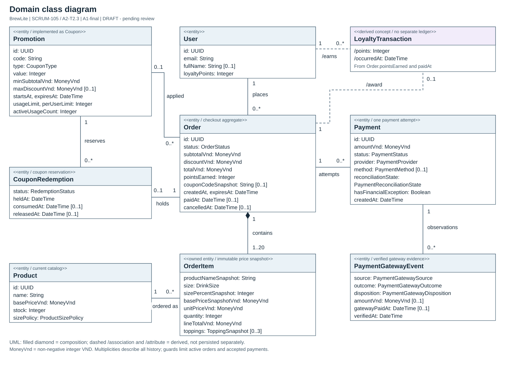
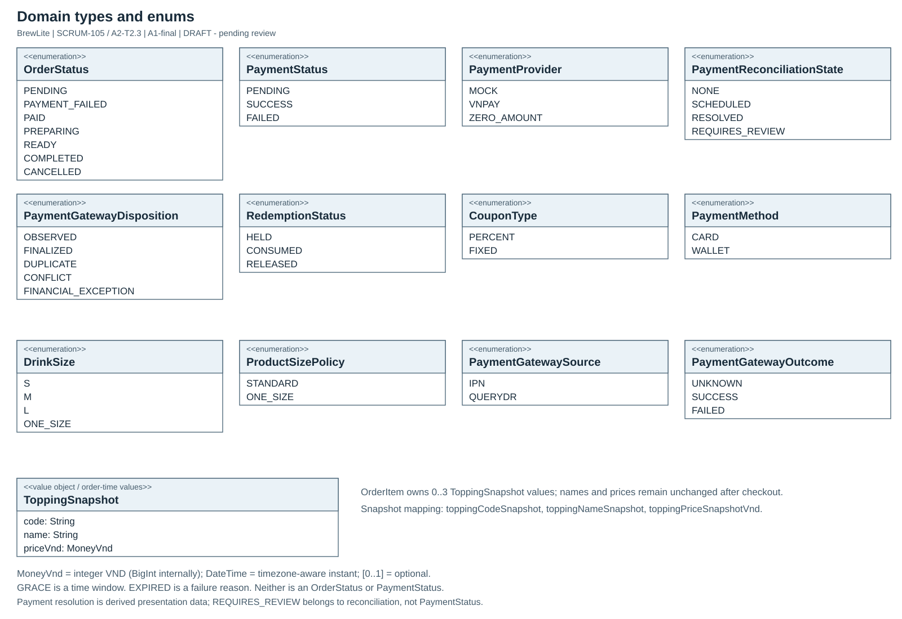

# Domain Class Diagram của BrewLite

| Thuộc tính | Giá trị |
| --- | --- |
| Task | SCRUM-105 / A2-T2.3 |
| Trạng thái | UPDATED — xử lý review vòng 1 của PR #5; chờ reviewer xác nhận, chưa nghiệm thu/merge. |
| Ngày soạn | 08/11/2026 |
| Ngày đối chiếu sau review | 09/11/2026 |
| Baseline nghiệp vụ | `A1-final^{commit}` = `1951dc124c83359556f04adb6ba3f0ee9f22fce4`. |
| Đối chiếu A2 | `origin/dev` sau fetch tại `2c432159ec8eb47ea315c3af25c1739d0f04dd4d`; SRS SCRUM-102 và Checkout UC SCRUM-100 đã merge. |

Backend, frontend và database không có diff so với A1-final tại snapshot `dev` đối chiếu này. Branch SCRUM-105 chưa pull/merge/rebase `dev`; các tài liệu Task 1 mới được đọc qua Git object và ghim permalink. Chi tiết nguồn, mapping và xác nhận retry nằm trong [bản xử lý review vòng 1](domain-review-followup.md).

Mô hình tập trung vào Checkout, Payment, Promotion và Loyalty. Mục tiêu là giải thích đối tượng nghiệp vụ, snapshot và quan hệ xuyên suốt vòng đời đơn hàng. Đây là mô hình phân tích domain, không phải đề xuất đổi schema hoặc khẳng định backend đã triển khai các class theo kiểu DDD.

## 1. Tạo phẩm và cách sử dụng

| File | Mục đích |
| --- | --- |
| [brewlite-domain-class.drawio](brewlite-domain-class.drawio) | Nguồn UML có thể mở/chỉnh sửa bằng diagrams.net; hai tab Domain class diagram và Domain types and enums. |
| [render_domain.py](render_domain.py) | Nguồn khai báo class, thuộc tính, quan hệ và layout; sinh đồng thời Draw.io, SVG và PDF. |
| [brewlite-domain-class.svg](brewlite-domain-class.svg) | Hình vector sơ đồ domain chính. |
| [brewlite-domain-types.svg](brewlite-domain-types.svg) | Hình vector các enum và ToppingSnapshot. |
| [brewlite-domain-class.pdf](brewlite-domain-class.pdf) | PDF vector hai trang A3 landscape: domain chính, rồi enum/kiểu dữ liệu; có text để tìm kiếm. |
| [domain-class-figure.tex](domain-class-figure.tex) | Fragment chèn từng trang PDF vào báo cáo LaTeX. |
| [domain-review-followup.md](domain-review-followup.md) | Bằng chứng đối chiếu DC-03/04/05 với Task 1 đã merge và xác nhận retry ngày 09/11/2026. |
| [domain-class-check.tex](../report/domain-class-check.tex) và [bản PDF tích hợp](../report/assets/domain-class-check.pdf) | Fixture báo cáo A4 để kiểm tra fragment, caption tiếng Việt, tham chiếu và bố cục landscape; không phải báo cáo A2 cuối. |





Nhãn trong hình dùng English để giữ tên class/field trùng source và tránh phụ thuộc font tiếng Việt khi xuất vector. Giải thích nghiệp vụ nằm trong tài liệu này.

## 2. Các class và ý nghĩa nghiệp vụ

Các thuộc tính chính cùng kiểu dữ liệu được ghi trực tiếp trong hình. Các ID/FK phụ, timestamp kỹ thuật, credential, JSON replay snapshot và lease của scheduler được lược bớt để hình đọc được. Việc lược bớt không có nghĩa các field đó bị xóa khỏi implementation.

| Class | Trách nhiệm và thuộc tính tiêu biểu | Ánh xạ A1-final |
| --- | --- | --- |
| User | Customer sở hữu Order, có email, fullName và số dư loyaltyPoints. Mật khẩu/hash không thuộc hình phân tích Checkout và không được trả ra API. | Prisma `User`; identity lấy từ JWT đã xác minh. |
| Product | Món hiện tại trong catalog: name, basePriceVnd, stock, sizePolicy. Giá/tên hiện tại có thể khác snapshot đơn cũ. | Prisma `Product`; `cart-pricing.ts`. |
| Order | Đơn hàng, tổng tiền đã chốt, thời hạn và lifecycle; chứa OrderItem và theo dõi các Payment attempt. | Prisma `Order`; `orders.service.ts`, `inventory-transaction.ts`. |
| OrderItem | Một cấu hình món và số lượng đã đặt; giữ productNameSnapshot, size, giá, thành tiền và topping snapshot. | Prisma `OrderItem`; dữ liệu được chốt khi tạo đơn. |
| Payment | Một lần thử thanh toán cho một Order; amountVnd, provider, method tùy provider, status và reconciliationState. | Prisma `Payment`; shared finalization. |
| Promotion | Khuyến mãi bằng mã coupon; type/value, thời hạn, điều kiện subtotal, mức giảm tối đa và quota. | **Cùng một khái niệm với Prisma `Coupon` trong baseline này**; không có bảng Promotion hoặc hierarchy Promotion → Coupon mới. |
| CouponRedemption | Lượt coupon được giữ cho một Order; trạng thái HELD/CONSUMED/RELEASED và các mốc thời gian. Được giữ lại vì có lifecycle nghiệp vụ riêng. | Prisma `CouponRedemption`; `promotion-policy.ts`. |
| LoyaltyTransaction | Khái niệm lần ghi nhận điểm cho một Order đã thanh toán hợp lệ. `/points = order.pointsEarned`; `/occurredAt = order.paidAt`. | **Khái niệm suy ra, chưa có class/table/ledger/API riêng.** Hiện trạng lưu số dư ở `User.loyaltyPoints` và điểm của từng Order ở `Order.pointsEarned`. |
| PaymentGatewayEvent | Chứng cứ gateway đã xác minh, có source, outcome và disposition; cho phép biểu diễn financial exception độc lập với kết quả được chấp nhận của Order. | Prisma `PaymentGatewayEvent`; không hiểu mọi event SUCCESS là Order PAID. |
| ToppingSnapshot | Value object gồm code, name, priceVnd ở thời điểm đặt; OrderItem chứa 0..3 giá trị. | Rút các field `toppingCodeSnapshot`, `toppingNameSnapshot`, `toppingPriceSnapshotVnd` từ `OrderItemTopping`; không tạo model mới. |

**Ranh giới LoyaltyTransaction:** Đây là cách biểu diễn khái niệm bắt buộc của đề trên dữ liệu đã có, không phải thiết kế ledger mới. Khi `paidAt != null`, một Order cho phép suy ra một bản ghi khái niệm, kể cả khi pointsEarned=0. Order chưa được chấp nhận thanh toán không có bản ghi này. Khóa nhận diện ngữ nghĩa là Order nguồn; không phát minh transaction ID, loại EARN/REDEEM, API lịch sử điểm hoặc nghiệp vụ trừ/hoàn điểm. Không suy diễn rằng số dư User luôn có thể tái dựng đầy đủ từ dữ liệu Order lịch sử/seed.

## 3. Quan hệ và multiplicity

Multiplicity ở hai đầu tính trên toàn bộ lịch sử. Giới hạn số đối tượng **đang active** và các invariant có điều kiện được mô tả riêng; không thay quan hệ Order–Payment thành 1–1 chỉ vì tối đa một SUCCESS.

| Quan hệ | Multiplicity và ý nghĩa |
| --- | --- |
| User — Order | Mỗi Order thuộc đúng 1 User; một User có 0..* Order trong lịch sử. Mỗi User chỉ có tối đa 1 Order active PENDING/PAYMENT_FAILED, gồm Grace. |
| Order ◆— OrderItem | Một Order hợp lệ chứa 1..20 dòng theo CreateOrderDto; mỗi OrderItem thuộc 1 Order. Composition mô tả quyền sở hữu/lifecycle nghiệp vụ, không yêu cầu SQL cascade delete. |
| Product — OrderItem | Mỗi OrderItem tham chiếu đúng 1 Product; Product có 0..* dòng trong lịch sử. Thông tin hiển thị đơn cũ lấy từ snapshot. |
| Order — Payment | Mỗi Payment attempt thuộc đúng 1 Order; Order có 0..* attempt. Tối đa 1 SUCCESS và 1 VNPay PENDING cho một Order. |
| Promotion — Order | Mỗi Order áp dụng 0..1 Promotion; một Promotion có thể xuất hiện ở 0..* Order. Snapshot coupon code/discount được giữ trên Order. |
| Order — CouponRedemption | Mỗi Order có 0..1 lượt giữ coupon; mỗi redemption thuộc đúng 1 Order. |
| Promotion — CouponRedemption | Mỗi redemption giữ đúng 1 Promotion; Promotion có 0..* redemption, kể cả lịch sử RELEASED. |
| User — LoyaltyTransaction | Mỗi bản ghi khái niệm thuộc đúng 1 User qua Order; User có 0..* bản ghi suy ra. |
| Order — LoyaltyTransaction | Mỗi bản ghi khái niệm có đúng 1 Order nguồn; Order có 0..1 bản ghi, chỉ suy ra khi paidAt đã có. |
| Payment — PaymentGatewayEvent | Mỗi event thuộc đúng 1 Payment; Payment có 0..* event. Không yêu cầu Mock/ZERO_AMOUNT phải có gateway event. |

`Payment.userId` và `CouponRedemption.userId` được kiểm tra nhất quán với Order owner, nhưng không vẽ thêm các cạnh FK trùng lặp. Category và catalog Topping nằm ngoài hình tập trung Checkout; quan hệ cấu hình Product–Topping vẫn tồn tại trong implementation. `ProductTopping` là liên kết cấu hình, không cần thành một domain class độc lập. `OrderItemTopping` được biểu diễn bằng ToppingSnapshot vì tên/giá đã chốt mới là ý nghĩa quan trọng đối với đơn.

Đường nét đứt và tiền tố `/` trong hình dùng để nhận biết quan hệ/thuộc tính suy ra của LoyaltyTransaction. Các quan hệ khác không ngụ ý có thể thao tác trực tiếp từ client hoặc bỏ qua Service/transaction.

## 4. Kiểu dữ liệu và trạng thái

- `MoneyVnd`: số nguyên VND không âm, tính bằng BigInt nội bộ; JSON API chỉ trả safe integer number. Đây là ký hiệu domain, không phải class/Prisma model mới.
- `Integer`: số nguyên; quantity 1..10 mỗi dòng, tối đa 20 dòng; stock/points không âm. `Promotion.value` là phần trăm khi PERCENT và VND khi FIXED.
- `UUID`, `String`, `Boolean` theo ý nghĩa thông thường; `DateTime` là một thời điểm có timezone; `[0..1]` biểu diễn optional, tương ứng nullable nếu lưu database.
- `Payment.method` CARD/WALLET thuộc Mock legacy; provider VNPAY/ZERO_AMOUNT có thể không có method. Provider và method là hai khái niệm riêng.

Toàn bộ 12 enum sử dụng trong hình được giữ đúng tên/value của `schema.prisma` tại A1-final:

| Trục | Giá trị |
| --- | --- |
| OrderStatus | PENDING, PAYMENT_FAILED, PAID, PREPARING, READY, COMPLETED, CANCELLED |
| PaymentStatus | PENDING, SUCCESS, FAILED |
| PaymentReconciliationState | NONE, SCHEDULED, RESOLVED, REQUIRES_REVIEW |
| PaymentProvider | MOCK, VNPAY, ZERO_AMOUNT |
| PaymentMethod | CARD, WALLET |
| RedemptionStatus | HELD, CONSUMED, RELEASED |
| CouponType | PERCENT, FIXED |
| DrinkSize | S, M, L, ONE_SIZE |
| ProductSizePolicy | STANDARD, ONE_SIZE |
| PaymentGatewaySource | IPN, QUERYDR |
| PaymentGatewayOutcome | UNKNOWN, SUCCESS, FAILED |
| PaymentGatewayDisposition | OBSERVED, FINALIZED, DUPLICATE, CONFLICT, FINANCIAL_EXCEPTION |

`GRACE` là cửa sổ thời gian, không phải OrderStatus; `EXPIRED` có thể là failureReason, không phải PaymentStatus. `resolution` là dữ liệu presentation dẫn xuất theo API v4.0 §14.4, không phải status được lưu: PROCESSING, RECONCILING, PAYMENT_ACCEPTED, FAILED, FINANCIAL_EXCEPTION, REQUIRES_REVIEW. Không thêm các giá trị này vào OrderStatus hoặc PaymentStatus.

## 5. Các invariant của Checkout

1. Giá cuối do server tính: `sizePriceVnd = round_half_up(basePriceVnd * sizePercent / 100)`, cộng topping, nhân quantity; subtotal là tổng dòng, totalVnd=subtotalVnd-discountVnd không âm. Payment dùng Order snapshot, không tính lại theo catalog tại IPN.
2. Create Order giữ stock và coupon HELD trong cùng transaction. FAILED hoặc retry không giữ thêm tài nguyên và không gia hạn expiresAt. Đơn không dùng coupon không có redemption.
3. Thanh toán được chấp nhận: Payment SUCCESS, Order PAID, coupon HELD→CONSUMED và cộng `floor(totalVnd/10000)` điểm đúng một lần trong cùng transaction; không trừ stock lần nữa. User.loyaltyPoints là số dư; Order.pointsEarned là kết quả cho đơn này.
4. ZERO_AMOUNT chỉ cho Order totalVnd=0 còn đủ điều kiện: Payment SUCCESS, Order PAID, điểm=0, không gọi Mock/VNPay. Mock chỉ được phép theo feature flag trong môi trường non-production.
5. TTL là 15 phút. Khi còn VNPay PENDING, Grace thêm 5 phút phục vụ xác minh khoản đã trả đúng hạn; không cho attempt mới từ expiresAt. Hết Grace unresolved: Order CANCELLED, release stock/coupon HELD một lần, Payment có thể vẫn PENDING để đối soát.
6. Payment SUCCESS/FAILED là terminal. Timeout, Return URL và event outcome=SUCCESS đứng riêng không cho phép tự PAID hoặc FAILED. Late/conflicting SUCCESS lưu evidence/financial exception; không hồi sinh CANCELLED Order, không tự refund hoặc cộng điểm.
7. Sau khi PAID, internal advance chỉ đi PAID→PREPARING→READY→COMPLETED, không đổi stock/coupon/points. Không thêm Cancel API/UI chủ động hoặc refund vào mô hình này.
8. Ownership lấy từ verified JWT và kiểm ở server. Replay không tạo attempt/side effect mới. Unique `(userId,idempotencyKey)` dùng chung các Payment API; nhiều FAILED lịch sử vẫn được phép.
9. Theo xác nhận nhận ngày 09/11/2026 cho DC-04: retry VNPay từ Order PAYMENT_FAILED **giữ Order.status=PAYMENT_FAILED** trong khi Payment attempt mới là PENDING. Đây là hai trục trạng thái riêng, phù hợp source A1-final; không tạo transition Order về PENDING trong bước initiate. Phạm vi và nguồn xác nhận được ghi trong [bản xử lý review §2](domain-review-followup.md#2-dc-04-xác-nhận-quy-tắc-retry).

Các invariant được đối chiếu source/contract, chưa phải kết quả chạy lại giao dịch, integration hoặc Sandbox E2E trong task tài liệu này.

## 6. Truy vết nguồn và điểm cần review

Các đường dẫn tương đối dưới đây thuộc repository ở commit đối chiếu đã nêu. Requirements/Use Case là nguồn mô tả, không thay thế bằng chứng runtime.

| Nhóm nội dung | Nguồn yêu cầu / thiết kế | Source A1-final đối chiếu |
| --- | --- | --- |
| Scope Checkout và ownership | [Context/Scope A2](../requirements/context-and-scope.md) §5–8; Requirements v3.1 FR-ORD-001/002/006, FR-AUTHZ; UC-ORD-001 | [orders.controller.ts](../../apps/api/src/orders/orders.controller.ts), [orders.service.ts](../../apps/api/src/orders/orders.service.ts) |
| Product, OrderItem, snapshot, tiền | [Requirements v3.1](../a1-archive/BrewLite_Requirements_Specification_v3.1.docx) FR-CAT-003, FR-ORD-002; [API v4.0](../a1-archive/api/BrewLite_API_Contract_v4.0.md) §14.1; UC-ORD-001, UC-CAT-002 | [cart-pricing.ts](../../apps/api/src/orders/cart-pricing.ts), [CreateOrderDto](../../apps/api/src/orders/dto/create-order.dto.ts), [schema.prisma](../../apps/api/prisma/schema.prisma) |
| Promotion/quota/redemption | Requirements FR-PRO-001/002/004; [UC v3.1](<../a1-archive/docs_Phase2/BrewLite_Use_Case_Specification_v3.1_VNPay_Phase_2 .pdf>) UC-ORD-001, UC-PRO-002 | [promotion-policy.ts](../../apps/api/src/promotions/promotion-policy.ts), OrdersService, schema Coupon/CouponRedemption |
| LoyaltyTransaction suy ra | Requirements FR-PRO-003, BR-06; API v4.0 §6/10/14.1; UC-PAY-001, UC-PRO-002 | [payment-finalization.service.ts](../../apps/api/src/payments/payment-finalization.service.ts), `calculateLoyaltyPoints` trong promotion-policy; User.loyaltyPoints, Order.pointsEarned/paidAt |
| Payment/status/evidence | API v4.0 §1/4/10/14.3–14.5; [BR-01…06](../a1-archive/decisions/VNPay_Phase2_Change_Request.md); [US–AC Phase 2](../a1-archive/docs_Phase2/BrewLite_User_Stories_Acceptance_Criteria_Phase2.docx) US-VNP-02/03/04/05; UC-PAY-001 | Prisma enums/Payment/PaymentGatewayEvent; PaymentFinalizationService |
| Expiry và fulfillment | Requirements FR-ORD-003/007; API v4.0 §14.2; UC-ORD-003 và UC-PAY-001 | [inventory-transaction.ts](../../apps/api/src/orders/inventory-transaction.ts), [order-state.service.ts](../../apps/api/src/orders/order-state.service.ts) |
| Giới hạn active/SUCCESS/PENDING | API v4.0 §14.3; Requirements §10.2–10.3 | [active Order migration](../../apps/api/prisma/migrations/20261022011000_scrum36_active_order_coupon_constraints/migration.sql), [one SUCCESS migration](../../apps/api/prisma/migrations/20261026065408_add_payment_schema/migration.sql), [VNPay delta migration](../../apps/api/prisma/migrations/20261031190100_scrum76_payment_gateway_delta/migration.sql) — chỉ đọc, không chạy migration |
| Task 1.2 A2 | [SRS SCRUM-102](https://github.com/brewlite-project/brewlite-a2/blob/50ef4be8beff005321ee6b44aa9e83d9d5202ee2/docs/requirements/srs.md) đã merge qua PR #7; FR/NFR và AC giữ đúng ID nguồn | Mapping 11 nhóm domain với FR/NFR được ghi ở [bản xử lý review §3](domain-review-followup.md#3-dc-05-mapping-frnfr-với-checkout-đã-merge); không gán AC PASS |
| Task 1.3 A2 | [Checkout UC bản 0.4](https://github.com/brewlite-project/brewlite-a2/blob/ac08a3a608ad7f2cbc5ea34642aa26130a164bdc/docs/requirements/A2_T1.3_Checkout_Use_Case_Specification.md) đã merge qua PR #3; Steps 1–11, AF03–09, EF-01–15, BR-C10 và §8.1/8.3 | Đối chiếu khái niệm, snapshot, attempt, coupon/loyalty và status với SRS; giữ riêng các gap runtime được UC nêu |

### Những khác biệt đã ghi nhận

| Mã | Vấn đề / rủi ro | Cách xử lý trong mô hình và hành động tiếp theo |
| --- | --- | --- |
| DC-01 | Đề yêu cầu Promotion và LoyaltyTransaction, nhưng Prisma không có model mang hai tên này. Vẽ như hai bảng mới sẽ mô tả sai A1. | Promotion ánh xạ 1 khái niệm vào Coupon; LoyaltyTransaction gắn nhãn derived và không có ledger riêng. Reviewer xác nhận cách biểu diễn này đáp ứng đề; task này không thiết kế persistence mới. |
| DC-02 | [ERD PDF cũ](../a1-archive/diagram/ERD/ERD.pdf) trang 1–3 và [database/schema.dbml](../../database/schema.dbml) còn PaymentStatus SUCCESS/FAILED, chưa có VNPay delta, đồng thời liệt kê InventoryMovement mà schema hiện tại không có. | Giữ nguồn lịch sử; ghi nhận lệch phiên bản. Enum/evidence lấy theo API v4.0 §14.3, Prisma và migration đã có tại A1-final; không thêm InventoryMovement vào domain hiện hành hoặc tự sửa ERD cũ. Owner ERD cần đồng bộ ở task riêng. |
| DC-03 | API v4.0 header ghi NOT APPROVED/Review 3, nhưng §14 ghi xác nhận input Approved; SRS/UC tiếp tục phân biệt nguồn, design và runtime. | Đã kiểm tra và giữ đúng trạng thái nguồn theo [bản xử lý review §1](domain-review-followup.md#1-snapshot-và-trạng-thái-nguồn). Không tự tuyên bố toàn bộ Contract Approved chỉ vì các task A2 đã merge/Done. Phần Document Control của nguồn còn do Leader quản lý. |
| DC-04 | Requirements v3.1 FR-ORD-003 mô tả retry PAYMENT_FAILED→PENDING; implementation VNPay giữ Order PAYMENT_FAILED khi tạo Payment PENDING. | Đã nhận xác nhận ngày 09/11/2026: **giữ Order PAYMENT_FAILED khi Payment mới PENDING**. Ghi nguồn xác nhận, phạm vi và evidence code trong [bản xử lý review §2](domain-review-followup.md#2-dc-04-xác-nhận-quy-tắc-retry); bổ sung chú thích hình/caption, không sửa backend. Owner Requirements cần đồng bộ câu cũ ở task nguồn. |
| DC-05 | Bản đầu thiếu tài liệu Task 1 trên dev; snapshot mới đã có SRS và Checkout UC merge. | Đã đối chiếu với SRS commit `50ef4be8` và Checkout UC 0.4 commit `ac08a3a`; mapping FR/NFR/AC và kết luận từng nhóm ở [bản xử lý review §3](domain-review-followup.md#3-dc-05-mapping-frnfr-với-checkout-đã-merge). Không cần thay class/multiplicity, không tự đóng các gap runtime hoặc nâng approval nguồn. |

DC-02 là lệch phiên bản tài liệu đã có delta hỗ trợ, không phải quyền đổi schema. DC-04 dùng xác nhận đã nhận, không tự đoán transition. Thiếu Payment Status route và QueryDR Sandbox E2E tiếp tục được SRS/UC mới giữ làm giới hạn riêng; hình Payment/evidence không chứng minh các route hoặc tích hợp đó đã PASS. Các kết quả xử lý cần reviewer PR #5 xác nhận trước khi approve.

## 7. Tái tạo và đưa vào báo cáo

Chạy từ root repo, với Python 3.10+ và ReportLab đã cài:

```powershell
python docs/diagrams/render_domain.py
git diff --check
```

Nếu môi trường Python riêng của bạn chưa có thư viện, cài `reportlab` vào môi trường đó trước khi chạy. Generator không cần PlantUML, Graphviz, server render hoặc database. Giữ phần khai báo trong `render_domain.py` làm nguồn tái tạo; nếu sửa trực tiếp Draw.io, đồng bộ lại khai báo trước khi regenerate để tránh ghi đè thay đổi.

PDF sử dụng vector và font chuẩn PDF; SVG giữ text/vector. In trực tiếp có thể dùng A3 landscape. Báo cáo A4 nên dành riêng một trang landscape cho mỗi hình, không đặt cả hai vào cùng một figure hoặc một cột hẹp. Đọc và kiểm tra cỡ chữ sau khi ghép báo cáo theo template thật.

Thêm `graphicx` và `pdflscape` trong preamble, rồi từ root repo:

```latex
\input{docs/diagrams/domain-class-figure.tex}
```

Nếu compile từ `docs/report/`, đặt đường dẫn trước khi input:

```latex
\newcommand{\BrewLiteDiagramDir}{../diagrams}
\input{../diagrams/domain-class-figure.tex}
```

Fragment dùng Vietnamese theo cấu hình của report (ví dụ `vntex` hoặc Unicode engine/font hỗ trợ tiếng Việt), không thay đổi template chung. PDF vector không cần `--shell-escape` hay bước convert SVG trong LaTeX.

Có fixture [domain-class-check.tex](../report/domain-class-check.tex) dùng `fontspec` và TeX Gyre Termes để kiểm tra tích hợp A4 bằng XeLaTeX/LuaLaTeX hoặc Tectonic. Font được chọn theo tên file của TeX để không phụ thuộc Arial có cài trên máy hay không. Từ root repo:

```powershell
tectonic -p --keep-logs --outdir docs/report/assets docs/report/domain-class-check.tex
```

Từ `docs/report/`:

```powershell
tectonic -p --keep-logs --outdir assets domain-class-check.tex
```

Fixture tự chọn đường dẫn tương đối; bản xuất kiểm chứng là `docs/report/assets/domain-class-check.pdf`. Phạm vi và kết quả chạy thực tế được ghi trong [bản xử lý review §4](domain-review-followup.md#4-pdf-và-latex). Chưa thay thế bước ghép vào template báo cáo A2 cuối của nhóm.

## 8. Kiểm chứng và điều kiện bàn giao

- Kiểm tra đủ 7 class bắt buộc; 9 class trong hình chính và ToppingSnapshot bổ trợ.
- Đối chiếu 12 enum với Prisma; kiểm tra đầu mút quan hệ, multiplicity và mapping derived.
- Parse nguồn Draw.io/SVG, kiểm tra PDF hai trang, text và font; render PDF thành PNG để xem clipping, overlap và độ rõ.
- Kiểm tra generator tái tạo byte-for-byte và `git diff --check`.
- Backend/frontend build, unit, integration, E2E không chạy lại cho thay đổi chỉ tài liệu; không có sửa source ứng dụng, schema hoặc migration. Không ghi kết quả test lịch sử là kết quả chạy trong task này.
- Kiểm chứng fragment LaTeX bằng fixture A4 và render PDF tích hợp; kết quả chi tiết tại bản xử lý review §4. Việc import/chỉnh sửa qua UI Draw.io và ghép template báo cáo cuối vẫn cần reviewer kiểm tra trong môi trường của nhóm.

**Trước nghiệm thu:** reviewer kiểm tra bản xử lý vòng 1, xác nhận nguồn/hình và bản ghép LaTeX. PR #5 đã mở với base `dev`; thay đổi follow-up cần commit/push sau khi người dùng cho phép, rồi review lại trước merge. Không tự ghi Jira Done hoặc tạo bằng chứng approval/merge.
