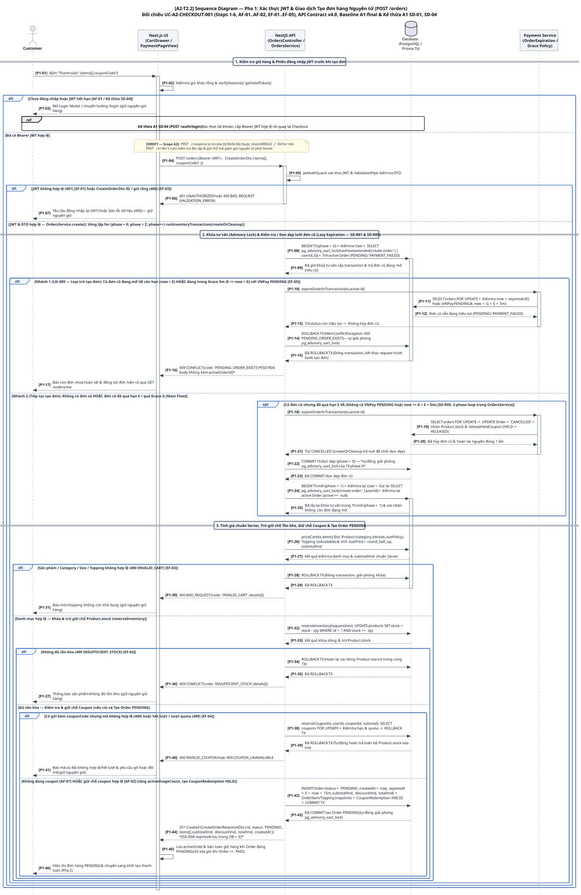
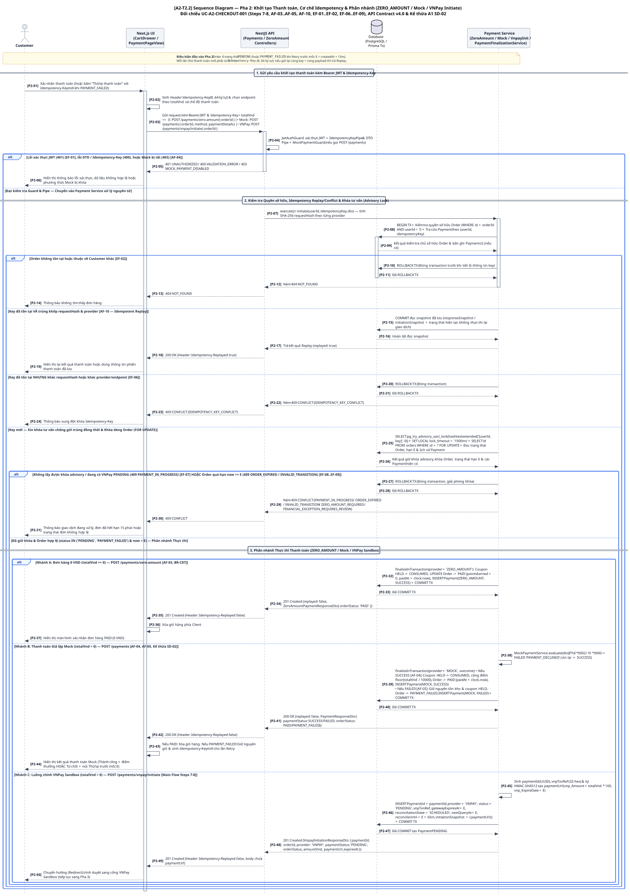
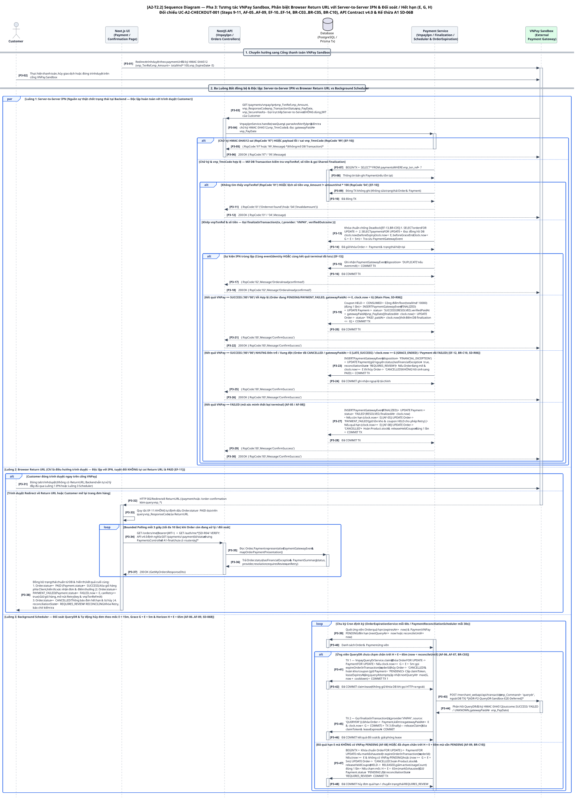
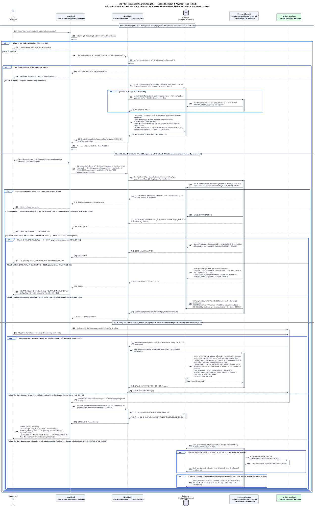

# [A2-T2.2] Chuẩn hóa Sequence Diagram — Checkout & Payment (`UC-A2-CHECKOUT-001`)

- **Mã công việc:** `SCRUM-104` / `A2-T2.2`
- **Trạng thái:** `READY FOR REVIEW — Đã cập nhật theo phản hồi PR #8 (Review vòng 1 & vòng 2: SD-R01..SD-R06)`
- **Ngày cập nhật:** `08/11/2026`
- **Baseline đối chiếu:** `A1-final` (`1951dc124c83359556f04adb6ba3f0ee9f22fce4`) và nhánh `dev` (`f5b67a5`) của `brewlite-project/brewlite-a2`
- **Use Case trọng tâm:** `UC-A2-CHECKOUT-001` (*Checkout — Đặt hàng từ giỏ hàng, giữ chỗ nguyên tử, khởi tạo thanh toán có kiểm soát idempotency và hoàn tất/đối soát trạng thái thanh toán*, đã chuẩn hóa tại `A2-T1.3 / SCRUM-100` và `A2-T2.1 / SCRUM-103`)

---

## 1. Mục đích, Phạm vi & Kế thừa từ Assignment 1

Tài liệu và bộ sơ đồ tuần tự (Sequence Diagram) trong thư mục [`docs/diagrams/sequence_diagram/`](./) chuẩn hóa luồng tương tác theo thời gian giữa các thành phần cho Use Case trọng tâm **Checkout & Payment (`UC-A2-CHECKOUT-001`)** theo đúng yêu cầu của **Mục 4.2 — Task 2.2 (Sequence Diagram)** trong đề bài Assignment 2.

### 1.1. Bảng đối chiếu kế thừa từ Sequence Diagram Assignment 1 (`SD-01`..`SD-06`)

| Mã Sequence A1 | Nguồn A1 (`docs/diagram/Sequence/`) | Vai trò trong A1 | Cách kế thừa & Chuẩn hóa tại Assignment 2 (`A2-T2.2`) |
| :--- | :--- | :--- | :--- |
| **`SD-01`** | `Sequence_Brewlite-Page-1.drawio.svg` (*Tạo đơn hàng từ giỏ hàng*) | Mô tả kiểm tra JWT, xử lý đơn cũ hết hạn, kiểm tra giỏ/tồn kho/coupon và tạo đơn `PENDING` nguyên tử (`expiresAt = createdAt + 15m`). | **Kế thừa & chuẩn hóa tại Pha 1** ([`sequence-checkout-phase1-order.puml`](./sequence-checkout-phase1-order.puml)): bổ sung khóa tư vấn `pg_advisory_xact_lock('create-order:' \|\| userId)`, tổ chức khối `alt` **loại trừ lẫn nhau (`SD-R01`)** giữa nhánh lỗi `409 PENDING_ORDER_EXISTS` và nhánh tạo đơn, đồng thời mô tả chính xác **vòng lặp 2 pha `for (phase = 0; phase < 2; phase++)` (`SD-R05`)** của `OrdersService.create`: khi `COMMIT TX (phase = 0)` dọn đơn cũ thì khóa tư vấn cấp transaction tự động được giải phóng, sau đó `phase = 1` mở `BEGIN TX` mới và gọi lại `SELECT pg_advisory_xact_lock('create-order:' \|\| userId)` trước khi kiểm tra lại `active Order` và tạo đơn mới. |
| **`SD-02`** | `Sequence_Brewlite-Page-2.drawio.svg` (*Thanh toán đơn hàng bằng Ví/Thẻ giả lập*) | Mô tả kiểm tra quyền sở hữu, tra cứu `Idempotency-Key`, khóa `Order FOR UPDATE`, gọi Mock Payment, cộng điểm thưởng và xóa giỏ hàng khi `PAID`. | **Kế thừa & mở rộng tại Pha 2** ([`sequence-checkout-phase2-payment-init.puml`](./sequence-checkout-phase2-payment-init.puml)): thống nhất giao thức `Idempotency-Key` (`requestHash` SHA-256 theo từng provider, `Idempotency-Replayed: true`, `409 IDEMPOTENCY_KEY_CONFLICT`, `pg_try_advisory_xact_lock` $\rightarrow$ `409 PAYMENT_IN_PROGRESS`) cho cả 3 nhánh: **`ZERO_AMOUNT` (`0 VND`)**, **`Mock` (`CARD`/`WALLET` có `MockPaymentGuard`)**, và **luồng chính `VNPay Sandbox` (`POST /payments/vnpay/initiate`)**. |
| **`SD-03`** | `Sequence_Brewlite-Page-3.drawio.svg` (*Đăng ký tài khoản Customer*) | Luồng đăng ký tài khoản mới (`POST /auth/register`). | **Giữ nguyên ở A1 (Out of Scope của Checkout):** không vẽ lại theo đúng giới hạn đề bài. |
| **`SD-04`** | `Sequence_Brewlite-Page-4.drawio.svg` (*Đăng nhập bằng Email/Password*) | Xác minh mật khẩu và cấp `Bearer JWT`. | **Tham chiếu qua khối `ref` tại đầu Pha 1** khi Customer chưa đăng nhập hoặc token hết hạn (`AF-01`), sau đó nối tiếp vào `POST /orders`. |
| **`SD-05`** | `Sequence_Brewlite-Page-5.drawio.svg` (*Chuyển trạng thái xử lý đơn hàng nội bộ/demo*) | Endpoint vận hành nội bộ `POST /internal/orders/:id/advance` (`X-Internal-Key`) sau khi đơn đã `PAID`. | **Giữ nguyên ở A1 (Hậu điều kiện sau Checkout):** bắt đầu từ trạng thái `Order == PAID` do Checkout tạo ra. |
| **`SD-06`** | `Sequence_Brewlite-Page-6.drawio.svg` (*Hủy đơn hàng và tự động hết hạn*) | Phần A: Khách hàng chủ động hủy đơn (`FR-ORD-005`). Phần B: Tác vụ nền tự động hủy đơn quá hạn `expiresAt <= now` và hoàn tồn kho/coupon đúng 1 lần. | **Phân tách rõ theo hiện trạng `A1-final`:**<br>• **Phần A (Customer chủ động hủy đơn — `FR-ORD-005`)** đang ở trạng thái **Deferred** (chưa có API/UI ở `A1-final`), do đó **không đưa vào luồng chính**.<br>• **Phần B (Tự động hết hạn & hoàn tài nguyên)** được **kế thừa & chuẩn hóa tại Pha 3** ([`sequence-checkout-phase3-vnpay-ipn-reconciliation.puml`](./sequence-checkout-phase3-vnpay-ipn-reconciliation.puml)), kết hợp với cửa sổ Grace 5 phút (`G = E + 5m`), chân trời đối soát `H = E + 65m`, phân biệt rõ `gatewayPaidAt` (`vnp_PayDate`) với `clock.now` (`SD-R06`) và mô hình 3 transaction của `VnpayQueryDrService`. |

---

## 2. Cấu trúc Bộ Sơ đồ, Tối ưu Bố cục Trang Riêng trong Báo cáo LaTeX (`SD-R02`) & Quản lý Vòng đời Transaction (`SD-R03`)

Để đảm bảo khả năng đọc rõ nét trên trang báo cáo LaTeX khổ A4 (`SD-R02`), cả 4 file PlantUML đã được tối ưu hóa mật độ dòng (`skinparam style strictuml` loại bỏ khối footer lifeline lặp lại ở đáy sơ đồ, `skinparam dpi 96`, `maxMessageSize 310..320`, `Padding 1`, rút gọn số dòng xuống dòng trong từng thông điệp), giúp giảm chiều cao các sơ đồ pha xuống dưới `3000 px` (`2803..2979 px`) và tỷ lệ khung hình đạt `1.38..1.52` (gần sát tỷ lệ khung nội dung trang A4 dọc `~1.45`).

Trong file LaTeX [`docs/report/sections/sequence-diagram.tex`](../../report/sections/sequence-diagram.tex), mỗi sơ đồ Pha 1, Pha 2, Pha 3 được bố trí trên **một trang hình riêng biệt (`\clearpage` + `\begin{figure}[p]` với `height=0.90\textheight`)**, còn sơ đồ tổng thể End-to-End (`sequence-checkout.pdf`) được đặt tại tiểu mục tổng hợp cuối chương ở chế độ toàn trang riêng (`[p]`, `height=0.92\textheight`) kèm vector PDF cho phép phóng đại không vỡ nét.

Đồng thời, theo yêu cầu **`SD-R03`**, mọi nhánh lỗi/rollback và mọi giao dịch con (`BEGIN TX` $\rightarrow$ `COMMIT TX` / `ROLLBACK TX`) đều có cặp `activate` / `deactivate` tường minh trên các lifeline `Database`, `Payment Service` và `NestJS API`.

| STT | Tên file nguồn (`.puml`) | Bản xuất Vector (`.svg` / `.pdf`) | Bản sao cho Báo cáo LaTeX (`docs/report/assets/`) | Kích thước chuẩn hóa (`dpi 96`) & Bố trí trong LaTeX (`SD-R02`) |
| :--: | :--- | :--- | :--- | :--- |
| **1** | [`sequence-checkout.puml`](./sequence-checkout.puml) | [`sequence-checkout.svg`](./sequence-checkout.svg)<br>[`sequence-checkout.pdf`](./sequence-checkout.pdf) | `docs/report/assets/sequence-checkout.pdf` | **`2192 x 4028 px` (tỷ lệ `1.84`) — Sơ đồ Tổng thể (End-to-End):** Đặt trên trang riêng `[p]` cuối chương (`height=0.92\textheight`) để tra cứu tổng quan 82 thông điệp xuyên suốt 3 pha. |
| **2** | [`sequence-checkout-phase1-order.puml`](./sequence-checkout-phase1-order.puml) | [`sequence-checkout-phase1-order.svg`](./sequence-checkout-phase1-order.svg)<br>[`sequence-checkout-phase1-order.pdf`](./sequence-checkout-phase1-order.pdf) | `docs/report/assets/sequence-checkout-phase1-order.pdf` | **`1836 x 2803 px` (tỷ lệ `1.52`) — Pha 1 (`POST /orders`):** Trang hình riêng `[p]` (`height=0.90\textheight`, lấp đầy ~95% bề ngang trang A4), thể hiện rõ khối `alt` loại trừ `409 PENDING_ORDER_EXISTS` (`SD-R01`) và vòng lặp 2 transaction `phase = 0` $\rightarrow$ `phase = 1` (`SD-R05`). |
| **3** | [`sequence-checkout-phase2-payment-init.puml`](./sequence-checkout-phase2-payment-init.puml) | [`sequence-checkout-phase2-payment-init.svg`](./sequence-checkout-phase2-payment-init.svg)<br>[`sequence-checkout-phase2-payment-init.pdf`](./sequence-checkout-phase2-payment-init.pdf) | `docs/report/assets/sequence-checkout-phase2-payment-init.pdf` | **`2110 x 2979 px` (tỷ lệ `1.41`) — Pha 2 (Khởi tạo Thanh toán & Idempotency):** Trang hình riêng `[p]` (`width=\linewidth,height=0.90\textheight`), khớp khít tỷ lệ khung trang A4 dọc, thể hiện rõ kiểm tra quyền sở hữu, `Idempotency-Key` và 3 nhánh (`ZERO_AMOUNT`, `Mock`, `VNPay Initiate`). |
| **4** | [`sequence-checkout-phase3-vnpay-ipn-reconciliation.puml`](./sequence-checkout-phase3-vnpay-ipn-reconciliation.puml) | [`sequence-checkout-phase3-vnpay-ipn-reconciliation.svg`](./sequence-checkout-phase3-vnpay-ipn-reconciliation.svg)<br>[`sequence-checkout-phase3-vnpay-ipn-reconciliation.pdf`](./sequence-checkout-phase3-vnpay-ipn-reconciliation.pdf) | `docs/report/assets/sequence-checkout-phase3-vnpay-ipn-reconciliation.pdf` | **`2139 x 2944 px` (tỷ lệ `1.38`) — Pha 3 (VNPay Return URL vs IPN & Đối soát):** Trang hình riêng `[p]` (`width=\linewidth,height=0.90\textheight`), khớp khít khung trang A4 dọc, thể hiện rõ khối `par` 3 luồng độc lập và phân biệt `gatewayPaidAt <= E` với `clock.now < G` (`SD-R06`). |

---

## 3. Kiểm tra Lifeline & Đối chiếu Kiến trúc Thực tế (`A1-final`)

Theo yêu cầu đề bài (*"Tối thiểu thể hiện các lifeline: `Customer` → `Next.js UI` → `NestJS API` → `Database` → `Payment Service`"*), cả 4 sơ đồ đều giữ đúng thứ tự lifeline chuẩn từ trái sang phải, bổ sung `VNPay Sandbox` ở ngoài cùng bên phải khi có giao tiếp cổng thanh toán bên ngoài:

1. **`Customer` (Actor):** Khách hàng thực hiện thao tác đặt hàng, xác nhận thanh toán, tương tác trên cổng VNPay Sandbox (hoặc đóng trình duyệt) và nhận thông báo kết quả cuối cùng.
2. **`Next.js UI` (`CartDrawer.tsx`, `PaymentPageView.tsx`, `order.service.ts`, `payment.service.ts`, `order-confirmation.service.ts`):**
   - Kiểm tra phiên đăng nhập (`verifySession()` / `getValidToken()`) trước khi gọi API.
   - Bảo toàn giỏ hàng local khi `Order` đang `PENDING` hoặc `PAYMENT_FAILED`; **chỉ xóa giỏ hàng khi Backend xác nhận `Order == PAID`**.
   - Sinh `Idempotency-Key` (8..64 ký tự) cho mỗi lần thử thanh toán; bắt buộc sinh `Idempotency-Key` mới khi bấm **Retry** từ trạng thái `PAYMENT_FAILED`.
   - Khi nhận **Browser Return URL** từ VNPay, tuyệt đối không tự đánh dấu `PAID` (`EF-11`), mà thực hiện bounded polling `GET /orders/me` (mỗi 3 giây, tối đa 10 lần) kết hợp `GET /auth/me` để đọc trạng thái chuẩn từ Backend.
3. **`NestJS API` (`OrdersController`, `PaymentsController`, `ZeroAmountPaymentController`, `VnpayIpnController`, `OrdersService`):**
   - Thực thi `JwtAuthGuard` (`401 UNAUTHORIZED`), `ValidationPipe` / `CreatePaymentPipe` / `ZeroAmountPaymentPipe` / `IdempotencyKeyPipe` (`400 BAD_REQUEST`), và `MockPaymentGuard` (`403 MOCK_PAYMENT_DISABLED` nếu `MOCK_PAYMENT_ENABLED != true` hoặc `NODE_ENV == 'production'`).
   - Điều phối giao dịch tạo đơn nguyên tử (`OrdersService.create` / `runInventoryTransaction`) và ủy quyền xử lý thanh toán sang `Payment Service`.
4. **`Database` (`PostgreSQL / Prisma Transaction`):**
   - Thực thi khóa tư vấn cấp transaction (`pg_advisory_xact_lock('create-order:' || userId)` khi tạo đơn; `pg_try_advisory_xact_lock(hashtextextended(JSON.stringify([userId, idempotencyKey]), 0))` khi xử lý `Idempotency-Key` thanh toán).
   - Thực thi khóa dòng bi quan (`SELECT ... FOR UPDATE`) theo **thứ tự chuẩn `Order` trước $\rightarrow$ `Payment` sau (`[EF-13, BR-C05]`)** trong `PaymentFinalizationService` và `VnpayQueryDrService` để ngăn chặn deadlock giữa IPN, QueryDR và tiến trình hủy đơn tự động.
5. **`Payment Service` (`ZeroAmountPaymentService`, `PaymentsService`, `MockPaymentService`, `VnpayInitiationService`, `VnpayIpnService`, `PaymentFinalizationService`, `PaymentReconciliationScheduler`, `VnpayQueryDrService`, `OrderExpirationService`):**
   - Thực thi kiểm tra quyền sở hữu (`404 NOT_FOUND`), đối chiếu `Idempotency-Key` & `requestHash` SHA-256 (`Idempotency-Replayed: true` hoặc `409 IDEMPOTENCY_KEY_CONFLICT`).
   - Hội tụ toàn bộ việc chốt kết quả thanh toán (`ZERO_AMOUNT`, `Mock`, `VNPay IPN`, `VNPay QueryDR`) về **`PaymentFinalizationService.finalizeInTransaction`**.
   - Chạy cron định kỳ quét đối soát `QueryDR` (mỗi 30s) và tự động hết hạn đơn (mỗi 60s) theo mốc `E = createdAt + 15 phút`, cửa sổ Grace `G = E + 5 phút` và chân trời đối soát `H = E + 65 phút`.
6. **`VNPay Sandbox` (Hệ thống cổng thanh toán bên ngoài):**
   - Nhận chuyển hướng trình duyệt qua `paymentUrl` đã ký `HMAC-SHA512`.
   - Gọi callback **Server-to-Server IPN (`GET /payments/vnpay/ipn`)** trực tiếp về `NestJS API` (không qua trình duyệt, không dùng JWT của Customer).
   - Phản hồi truy vấn đối soát **QueryDR (`POST /merchant_webapi/api/transaction`, `vnp_Command = 'querydr'`)** từ `Payment Service`.

---

## 4. Phân tích Chi tiết Các Cơ chế Kỹ thuật Trọng tâm trên Sequence Diagram

### 4.1. Xác thực JWT, Khối `alt` Loại trừ `409` (`SD-R01`) & Cơ chế Lấy/Giải phóng `pg_advisory_xact_lock` qua Vòng lặp 2 Pha (`SD-R05`)



1. **Xác thực JWT 2 lớp (`AF-01`, `EF-01`):**
   - Phía Client (`CartDrawer.tsx` / `PaymentPageView.tsx`): gọi `verifySession()` / `getValidToken()`; nếu chưa có hoặc đã quá hạn `exp`, mở Login Modal / chuyển hướng sang `/login` (tham chiếu `SD-04`) và giữ nguyên giỏ hàng.
   - Phía Server (`OrdersController.create`): `JwtAuthGuard` xác minh chữ ký và thời hạn token trước khi vào `OrdersService.create`.
2. **Cơ chế vòng lặp 2 pha `for (let phase = 0; phase < 2; phase++)` và vòng đời khóa `pg_advisory_xact_lock` trong `OrdersService.create` (`SD-R01`, `SD-R05`):**
   - Trong `backend/src/orders/orders.service.ts` (L147–285), hàm `OrdersService.create` thực thi vòng lặp `for (let phase = 0; phase < 2; phase++) { const result = await runInventoryTransaction(this.prisma, createOrCleanup); if (result !== null) return result; }`:
   - **Tại `phase = 0` (`[P1-08]`..`[P1-09]`):** Mở `BEGIN TX (phase = 0)`, kiểm tra `User` tồn tại, gọi `SELECT pg_advisory_xact_lock(hashtextextended('create-order:' || userId, 0))` để lấy khóa tư vấn cấp transaction, và tìm đơn đang mở (`status IN ('PENDING', 'PAYMENT_FAILED')`).
   - **Khối `alt` loại trừ lẫn nhau (`SD-R01`):**
     - **Nhánh 1 (Lỗi `409 — Loại trừ tạo đơn`, `[P1-10]`..`[P1-17]`):** Nếu tìm thấy đơn cũ đang mở và `expireOrderInTransaction(tx, active.id)` xác nhận đơn vẫn còn hạn (`now < E`) hoặc đang trong cửa sổ Grace 5 phút (`E <= now < G`) với `VNPay PENDING`, `createOrCleanup` ném `ConflictException (409 PENDING_ORDER_EXISTS)`. Giao dịch `phase = 0` thực hiện **`ROLLBACK TX` (`[P1-14]` $\rightarrow$ `[P1-15]`), tự động giải phóng `pg_advisory_xact_lock`, đóng `deactivate DB` & `deactivate API`, trả `409 CONFLICT` và kết thúc ngay request trước bước tạo đơn**.
     - **Nhánh 2 (Tiếp tục tạo đơn, `[P1-18]`..`[P1-46]`):** Khi không có đơn cũ đang mở **hoặc** đơn cũ đã quá hạn `E` (và không vướng Grace `G`):
       - **Khối `opt` khi có đơn cũ quá hạn cần dọn dẹp (`SD-R05`, `[P1-18]`..`[P1-25]`):**
         1. `expireOrderInTransaction(tx, active.id)` chuyển đơn cũ sang `CANCELLED`, hoàn `Product.stock` và giải phóng `CouponRedemption (HELD -> RELEASED)`, sau đó `createOrCleanup` trả về `null` (`[P1-21]`).
         2. `runInventoryTransaction` ở `phase = 0` thực hiện **`COMMIT TX dọn dẹp (phase = 0)` (`[P1-22]` $\rightarrow$ `[P1-23]`, `deactivate DB`)**. Vì `pg_advisory_xact_lock` là khóa cấp transaction (transaction-level advisory lock), **khóa này tự động được PostgreSQL giải phóng ngay khi `COMMIT TX (phase = 0)`** (nhằm tránh đảo ngược thứ tự khóa `Coupon -> Product` giữa đơn cũ vừa giải phóng và đơn mới sắp giữ chỗ).
         3. Vòng lặp chuyển sang **`phase = 1` (`[P1-24]` $\rightarrow$ `[P1-25]`, `activate DB`)**: mở một giao dịch mới hoàn toàn (`BEGIN TX mới (phase = 1)`), kiểm tra lại `User`, **gọi lại `SELECT pg_advisory_xact_lock(hashtextextended('create-order:' || userId, 0))` để lấy lại khóa tư vấn trong TX mới**, và truy vấn lại `tx.order.findFirst` để xác nhận không còn đơn active nào (`active == null`) trước khi sang bước 3.
3. **Tính giá chuẩn Server, Trừ giữ chỗ tồn kho & Giữ chỗ Coupon (`EF-03`, `EF-04`, `SD-R03`):**
   - `priceCart(tx, items)` (`[P1-26]`): tính giá theo size bằng `round_half_up` và cộng giá topping; nếu lỗi thì `ROLLBACK TX` (giải phóng khóa advisory) và trả `400 INVALID_CART`.
   - `reserveInventory(tx, quantities)` (`[P1-32]`): trừ `Product.stock`; nếu thiếu tồn kho thì `ROLLBACK TX` và trả `409 INSUFFICIENT_STOCK`.
   - `reserveCoupon(tx, userId, couponId, subtotal)` (`[P1-38]`): khóa `Coupon FOR UPDATE`, tăng `activeUsageCount`, tạo `CouponRedemption (HELD)`; nếu lỗi thì `ROLLBACK TX` (hoàn lại `Product.stock` vừa trừ) và trả `400 INVALID_COUPON` / `409 COUPON_UNAVAILABLE`.
   - Tạo `Order (status = 'PENDING', createdAt = now, expiresAt = E = now + 15m)` (`[P1-42]`), `COMMIT TX` (tự động giải phóng `pg_advisory_xact_lock`), `deactivate DB`/`API` và trả `201 Created`.

---

### 4.2. Cơ chế Idempotency & Phân nhánh Khởi tạo Thanh toán (Pha 2 — `SD-R03` & `SD-R04`)



1. **Giao thức Idempotency thống nhất & Quản lý Khóa/Transaction (`AF-10`, `EF-02`, `EF-06`..`EF-09`, `SD-R03`):**
   - Mọi request tới `POST /payments/zero-amount`, `POST /payments` và `POST /payments/vnpay/initiate` đều bắt buộc đi qua `IdempotencyKeyPipe` (`Idempotency-Key` dài 8..64 ký tự).
   - Trong DB Transaction (`[P2-08]`):
     - **Kiểm tra quyền sở hữu trước tiên (`EF-02`):** Nếu `Order` không tồn tại hoặc thuộc về `userId` khác, hệ thống `ROLLBACK TX`, đóng lifeline và trả `404 NOT_FOUND`.
     - **Replay hợp lệ (`AF-10`):** Nếu tìm thấy bản ghi `(userId, idempotencyKey)` có cùng `requestHash` và cùng `provider`, hệ thống đọc `responseSnapshot` / `initiationSnapshot` đã lưu, `COMMIT` giao dịch đọc và trả ngay `200 OK` kèm header `Idempotency-Replayed: true`.
     - **Xung đột payload/provider (`EF-06`):** Nếu cùng `Idempotency-Key` nhưng khác `requestHash` hoặc khác `provider`/endpoint, hệ thống `ROLLBACK TX` và trả `409 IDEMPOTENCY_KEY_CONFLICT`.
     - **Khóa chống gửi trùng đồng thời & Khóa dòng Order (`EF-07`..`EF-09`):** Nếu là key mới, hệ thống gọi `SELECT pg_try_advisory_xact_lock(hashtextextended(JSON.stringify([userId, idempotencyKey]), 0))` và khóa `SELECT id FROM orders WHERE id = ? FOR UPDATE`. Mọi trường hợp không lấy được khóa, đang có `VNPay PENDING` (`409 PAYMENT_IN_PROGRESS`), đơn quá hạn `now >= E` (`409 ORDER_EXPIRED` / `409 INVALID_TRANSITION`), hoặc sai loại tổng tiền đều `ROLLBACK TX` tường minh trước khi trả `409`.
2. **Ba nhánh thực thi thanh toán:**
   - **Nhánh A — Đơn `0 VND` (`POST /payments/zero-amount`, `[AF-03, BR-C07]`):** Chuyển `Coupon HELD -> CONSUMED`, cập nhật `Order -> PAID (pointsEarned = 0, paidAt = clock.now)`, lưu `Payment (ZERO_AMOUNT, SUCCESS)`, `COMMIT TX` và trả `201 Created`.
   - **Nhánh B — Thanh toán giả lập `Mock` (`POST /payments`, `[AF-04, AF-05]`):** Nếu `SUCCESS`: chuyển coupon `HELD -> CONSUMED`, cộng điểm `floor(totalVnd / 10000)`, cập nhật `Order -> PAID (paidAt = clock.now)`, `Payment -> SUCCESS`. Nếu `FAILED`: giữ nguyên tồn kho & coupon `HELD`, cập nhật `Order -> PAYMENT_FAILED`, `Payment -> FAILED`.
   - **Nhánh C — Luồng chính `VNPay Sandbox` (`POST /payments/vnpay/initiate`, `[Main Flow]`):** Sinh `paymentId` (UUID) và `vnpTxnRef` mới (32-hex), ký `HMAC-SHA512` tạo `paymentUrl`, lưu `Payment (provider = 'VNPAY', status = 'PENDING', reconciliationState = 'SCHEDULED', nextQueryAt = E, reconcileUntil = E + 65m)`, `COMMIT TX` và trả `201 Created`.

---

### 4.3. Phân biệt Browser Return URL với Server-to-Server IPN, Thời điểm Thanh toán `gatewayPaidAt` vs Thời điểm Finalization `clock.now` (`SD-R06`) & Đối soát 3-Transaction (Pha 3)



1. **Làm rõ hai mốc thời gian trong `PaymentFinalizationService.finalizeVnpay` (`SD-R06`):**
   - Khi nhận callback từ VNPay (`VnpayIpnService` ở `[P3-04]`) hoặc kết quả đối soát (`VnpayQueryDrService` ở `[P3-44]`), hệ thống trích xuất trường **`vnp_PayDate`** từ payload đã xác thực chữ ký HMAC-SHA512 và gán vào **`evidence.gatewayPaidAt`** (thời điểm khách hàng thực sự hoàn tất thanh toán tại cổng VNPay).
   - Khi mở transaction chốt kết quả (`[P3-13]`), `PaymentFinalizationService` đọc đồng hồ cơ sở dữ liệu **`clock.now = clock_timestamp()`** (thời điểm backend thực hiện finalization) và tính hai cờ:
     - `beforeExpiry`: `clock.now < orders.expires_at` (`E = createdAt + 15m`)
     - `beforeGraceEnd`: `clock.now < orders.expires_at + 5 minutes` (`G = E + 5m`)
   - **Điều kiện chấp nhận thanh toán VNPay `SUCCESS ('00'/'00')` hợp lệ (`[P3-19]`, `payment-finalization.service.ts` L561–594):**
     1. **Kiểm tra thời điểm thanh toán tại cổng VNPay (`isPaidOnOrBeforeExpiry`, L577):** `gatewayPaidAt <= E` (`SELECT ${paidAt}::timestamptz <= expires_at`). Nếu `gatewayPaidAt > E`, giao dịch bị từ chối với lý do **`LATE_SUCCESS`** (`FINANCIAL_EXCEPTION`).
     2. **Kiểm tra thời điểm backend finalization trong cửa sổ Grace (`clock.beforeGraceEnd`, L587):** `clock.now < G = E + 5m` (và `Order` vẫn đang ở `PENDING` hoặc `PAYMENT_FAILED`, chưa bị hủy). Nếu `clock.now >= G`, giao dịch bị từ chối với lý do **`GRACE_ENDED`** (`FINANCIAL_EXCEPTION`).
   - **Cách lưu vết thời gian khi `SUCCESS` hợp lệ (`payment-finalization.service.ts` L613–638):**
     - Trên bảng **`Payment`**: lưu **`Payment.verifiedPaidAt = gatewayPaidAt`** (ghi nhận chính xác thời điểm thanh toán từ VNPay `vnp_PayDate` $\le E$) và **`Payment.finalizedAt = clock.now`** (thời điểm DB chốt giao dịch $< G$).
     - Trên bảng **`Order`**: cập nhật `Order.status = 'PAID'` và **`Order.paidAt = clock.now`** (thời điểm DB chính thức chuyển trạng thái đơn hàng sang `PAID`, có thể nằm trong khoảng `[E, G)` nếu IPN/QueryDR về trong cửa sổ Grace 5 phút sau khi khách đã trả tiền trước mốc `E`).
2. **Bảng so sánh 3 luồng bất đồng bộ trong khối `par` ở Pha 3:**

| Tiêu chí so sánh | Browser Return URL (Luồng 2 — Trình duyệt) | Server-to-Server IPN (Luồng 1 — `GET /payments/vnpay/ipn`) | Background Scheduler (Luồng 3 — `QueryDR` & Expiration) |
| :--- | :--- | :--- | :--- |
| **Chiều gọi & Kênh truyền** | Trình duyệt của Customer được VNPay `HTTP 302 Redirect` về `/payment` hoặc `/order-confirmation`. | Máy chủ `VNPay Sandbox` gọi HTTP GET trực tiếp tới `VnpayIpnController` trên `NestJS API`. | Cron nội bộ (`PaymentReconciliationScheduler` mỗi 30s; `OrderExpirationService` mỗi 60s). |
| **Xác thực** | Phiên trình duyệt của Customer; khi UI gọi `GET /orders/me` phải đính kèm `Authorization: Bearer <JWT>`. | **Không dùng JWT của Customer**; xác thực bằng chữ ký `HMAC-SHA512` (`vnp_SecureHash`), `vnp_TmnCode`, `vnp_TxnRef` và `vnp_Amount == amountVnd * 100`. | Nội bộ Backend; khi gọi `POST QueryDR` sang VNPay dùng chữ ký `HMAC-SHA512` với `vnp_HashSecret`. |
| **Quản lý Transaction (`SD-R03`)** | Các truy vấn đọc `GET /orders/me` độc lập. | • Lỗi chữ ký (`97`) / tham số (`99`): trả ngay **không mở DB TX**.<br>• Lỗi `vnpTxnRef` (`01`) / lệch tiền (`04`): đóng TX đọc mà không ghi.<br>• Hợp lệ: khóa `Order FOR UPDATE` $\rightarrow$ `Payment FOR UPDATE` và `COMMIT TX` trong `finalizeInTransaction`. | **Mô hình 3 Transaction tách biệt (`VnpayQueryDrService`):**<br>• **TX 1 (`claim`)**: Khóa `Order -> Payment`, hủy `Order` nếu `clock.now >= G`, cấp `claimToken` + `COMMIT` (không giữ khóa DB khi gọi HTTP).<br>• **HTTP Call**: Gọi `POST QueryDR` ngoài DB TX.<br>• **TX 2 (`finalizeInTransaction`)** + **TX 3 (`releaseClaim` trong `finally`)**. |
| **Độ tin cậy & Quyền cập nhật DB** | **Không tin cậy (`EF-11`):** Tuyệt đối không cập nhật `Order -> PAID` từ Return URL. | **Nguồn sự thật (Authoritative):** Chốt `PAID` (`gatewayPaidAt <= E` & `clock.now < G`), `PAYMENT_FAILED`, `CANCELLED` hoặc `FINANCIAL_EXCEPTION` (`REQUIRES_REVIEW`). | **Nguồn sự thật dự phòng (Fallback Authoritative):** Chốt kết quả khi IPN bị trễ/thất lạc, hủy đơn quá hạn tại `E`/`G` và đánh dấu `REQUIRES_REVIEW` tại `H = E + 65m`. |

---

## 5. Bảng Đối chiếu Chi tiết Implementation (`A1-final`) với `API Contract v4.0` & Các Điểm `[VERIFY]` / `Deferred` (`SD-R04`..`SD-R06`)

| Hạng mục đối chiếu | Mã nguồn thực tế tại Baseline `A1-final` | Đặc tả trong `API Contract v4.0` / `SRS v3.1` | Cách biểu diễn chuẩn xác trên Sequence Diagram (`A2-T2.2`) |
| :--- | :--- | :--- | :--- |
| **1. Vòng lặp 2 pha & khóa `pg_advisory_xact_lock` khi tạo đơn (`SD-R05`)** | `orders.service.ts` (L163–175, L279–285): chạy `for (let phase = 0; phase < 2; phase++) runInventoryTransaction(createOrCleanup)`. Khi đơn cũ đã quá hạn `E`/`G`, `expireOrderInTransaction` hủy đơn cũ rồi trả `null` để `COMMIT` giao dịch `phase = 0` (tự động giải phóng `pg_advisory_xact_lock`). Sau đó `phase = 1` mở transaction mới và gọi lại `SELECT pg_advisory_xact_lock('create-order:' \|\| userId)` trước khi kiểm tra lại `active Order` và tạo đơn mới. | `BR-C02`: mỗi Customer chỉ có tối đa 1 Order active; tuần tự hóa tạo đơn và giải phóng tài nguyên an toàn không gây deadlock. | Bước `[P1-18]`..`[P1-25]` trên Pha 1 và `[16]`..`[19]` trên sơ đồ tổng thể thể hiện rõ: `COMMIT TX dọn dẹp (phase = 0)` tự giải phóng khóa advisory cũ $\rightarrow$ `deactivate DB` $\rightarrow$ `BEGIN TX mới (phase = 1)` $\rightarrow$ `activate DB` + gọi lại `pg_advisory_xact_lock`. |
| **2. Thời điểm thanh toán `gatewayPaidAt` vs thời điểm chốt `clock.now` (`SD-R06`)** | `payment-finalization.service.ts` (L561–638): kiểm tra `gatewayPaidAt <= E` (`vnp_PayDate` từ VNPay $\le$ `orders.expires_at`) **và** `clock.now < G = E + 5m` (`beforeGraceEnd`). Khi hợp lệ, lưu `Payment.verifiedPaidAt = gatewayPaidAt`, `Payment.finalizedAt = clock.now`, và cập nhật `Order.paidAt = clock.now`. | `BR-C03` & `BR-C05`: Grace 5 phút `[E, E + 5m)` chỉ chấp nhận giao dịch VNPay phát sinh trước `E` (`paidAt <= E`) và được đối soát/chốt trước `G`. | Bước `[P3-19]`, `[P3-23]`, `[P3-45]` trên Pha 3 và `[63]`, `[79]` trên sơ đồ tổng thể ghi rõ điều kiện `(gatewayPaidAt <= E, clock.now < G)` và phân biệt rõ `Payment.verifiedPaidAt = gatewayPaidAt [vnp_PayDate]` với `Order.paidAt = clock.now [thời điểm DB finalization <= G]`. |
| **3. Phản hồi lỗi `409 PENDING_ORDER_EXISTS` (`SD-R04`)** | `orders.service.ts` (L29–35): ném `ConflictException({ code: 'PENDING_ORDER_EXISTS', message: 'An active order already exists' })` — **body lỗi không chứa `activeOrderId`**. UI đồng bộ đơn đang mở qua `GET /orders/me`. | `API Contract v4.0` §3 ghi mã lỗi `409 PENDING_ORDER_EXISTS`. | Bước `[P1-16]`..`[P1-17]` ghi rõ `409 CONFLICT (code: 'PENDING_ORDER_EXISTS') *[SD-R04: body không kèm activeOrderId]*` và UI đồng bộ qua `GET /orders/me`. |
| **4. Trường `expiresAt` của `Order` khi tạo đơn (`SD-R04`)** | `orders.service.ts` (L251–275) & `create-order-response.dto.ts`: lưu `expiresAt = now + 15m` trong DB, nhưng `CreateOrderResponseDto` của `201 Created` trả `createdAt`; `expiresAt` được trả qua `GET /orders/me` và `POST /payments/vnpay/initiate`. | `FR-ORD-004`: thiết lập `expiresAt = createdAt + 15m`. | Bước `[P1-42]` và `[P1-44]` thể hiện rõ `expiresAt = E = now + 15m` lưu trong DB và liệt kê đúng các trường của `CreateOrderResponseDto`. |
| **5. Tồn kho `Product.stock` vs `Topping` & giữ chỗ Coupon (`SD-R04`)** | Chỉ `Product` có cột `stock` (`Topping` kiểm tra `isAvailable`). `reserveCoupon` tăng `Coupon.activeUsageCount` và tạo `CouponRedemption (HELD)`. | `FR-INV-001..003`, `FR-PRO-002..004`. Bảng `InventoryMovement` (`FR-INV-004`) là `SHOULD` (chưa có trong `schema.prisma`). | Thể hiện chính xác trừ `Product.stock`, kiểm tra `Topping.isAvailable`, và vòng đời `CouponRedemption`: `HELD` $\rightarrow$ `CONSUMED` / `RELEASED`. |
| **6. `[VERIFY]` Endpoint `GET /payments/:paymentId/status` (`SD-R04`)** | `frontend/services/payment.service.ts` có hàm gọi, nhưng `PaymentsController` ở `A1-final` **chưa có route `@Get(':paymentId/status')`**. UI thực tế (`PaymentPageView.tsx`) thực hiện bounded polling **`GET /orders/me`** + `GET /auth/me`. | `API Contract v4.0` §5 (API-03) mô tả thiết kế `GET /payments/:paymentId/status`. | Bước `[P3-34]` và `[68]` vẽ đúng lời gọi thực tế `GET /orders/me` + `GET /auth/me` và đính kèm nhãn `*[SD-R04 / VERIFY]*`. |
| **7. `[VERIFY / Deferred]` `POST /coupons/preview`, `QueryDR Sandbox E2E` & `FR-ORD-005`** | `POST /coupons/preview` thuộc nhóm `SHOULD / Deferred`; `VnpayQueryDrService` hoãn nghiệm thu E2E Sandbox (`ADR-P2-QueryDR-Sandbox-E2E-Deferred`); hủy đơn chủ động `FR-ORD-005` là `Deferred`. | Ghi nhận tại `SRS v3.1`, `UC-A2-CHECKOUT-001` và `ADR-P2-QueryDR-Sandbox-E2E-Deferred.md`. | Ghi chú tường minh trong `note` đầu Pha 1, gắn nhãn `[ADR-P2-QueryDR-Sandbox-E2E-Deferred]` tại `[P3-43]`, và không đưa `FR-ORD-005` vào luồng chính. |

---

## 6. Sơ đồ Tổng thể End-to-End (`sequence-checkout.svg`)



---

## 7. Hướng dẫn Tái tạo Bản xuất SVG / PDF từ Nguồn PlantUML

Chạy từ thư mục gốc repository:

```powershell
java -jar C:\Users\USER\.vscode\extensions\jebbs.plantuml-2.18.1\plantuml.jar -tsvg -charset UTF-8 "docs/diagrams/sequence_diagram/*.puml"
```
